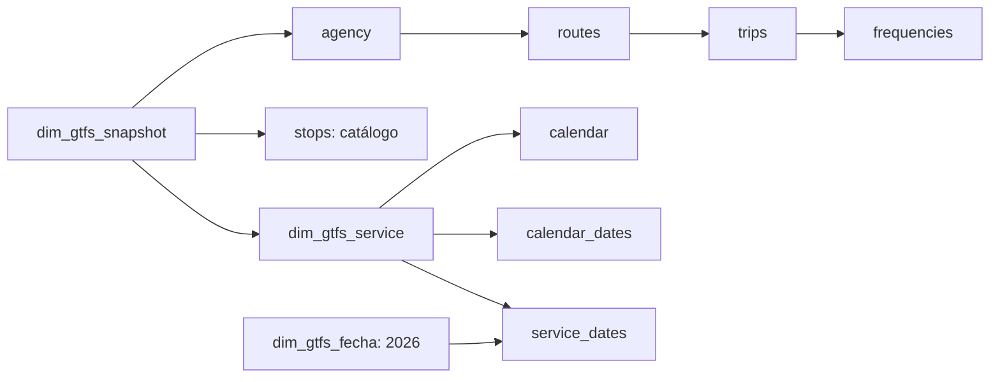

# Mi modelo de consumo GTFS

## Estado vigente — 20 de noviembre de 2026

Trabajo con cuatro tablas Gold importadas y cuatro paneles: Panorama, Programación, Red publicada y Revisión.
La navegación usa botones nativos con texto propio, estado activo rojo y efecto al pasar el cursor.
Retiré Laboratorio y sus accesos del menú principal.
Las tarjetas ilustradas filtran Panorama; los desplegables conservan la sincronización entre páginas.
La navegación ya funciona; la revisión integral del informe y su actualización completa siguen pendientes.
[Estado general](../../docs/project_status.md) y [navegación](../../docs/power_bi_navigation_images.md).

## Recorrido y referencias de implementación

Corregí el modelo abierto mediante MCP y exporté su definición completa al PBIP.
Conservé un respaldo antes de escribir.
Las nuevas claves y dimensiones calculadas pertenecen a Power BI; no modifican Silver ni publican Gold.

## Identidad y relaciones

Construí `snapshot_key` con longitud de versión, versión y hash.
Para una entidad añadí su ID fuente intacto después del snapshot.
Mantengo ceros iniciales y caracteres del ID.
Las ocho tablas importadas utilizan la misma expresión de identidad.
Las claves quedan ocultas en el panel de campos, pero siguen disponibles para las relaciones.

```dax
-- Expresión de la columna snapshot_key, dentro de cada tabla fuente.
FORMAT ( LEN ( [source_feed_version] ), "0" )
    & ":" & [source_feed_version]
    & ":" & [source_sha256]
```

La longitud permite interpretar la versión sin depender de un separador ausente en el texto.
SHA-256 conserva su longitud validada de 64 caracteres.
Añadir `":" & [agency_id]` produce agency_key; aplico el mismo patrón a route_id, trip_id y service_id.
Comprobé las claves con los datos importados y recalculé el modelo local.
Esta solución de consumo podrá trasladarse a las proyecciones Gold conservando una definición compartida.



Cada flecha de negocio filtra desde el lado único hacia el lado múltiple.
La relación de trips a frequencies admite muchas ventanas por viaje.
No conecté service_dates directamente con trips: no multiplico el catálogo de viajes por fechas activas ni creo otro camino ambiguo desde snapshot.
La programación por ruta y fecha llegará mediante su hecho Gold.
El calendario analítico filtra service_dates; los conteos de catálogo no se convierten por ello en programación diaria.

## Filtros que utilizaré

- Snapshot común: `dim_gtfs_snapshot[source_feed_version]`.
- Agencia publicada: `silver_gtfs_agency[agency_name]`.
- Ruta publicada: campos de `silver_gtfs_routes`.
- Fecha de servicio: `dim_gtfs_fecha[fecha]`, actualmente para service_dates.

Oculté versión y hash repetidos en las ocho tablas fuente para favorecer el filtro común.
Conservé esos valores visibles en dim_gtfs_snapshot.
Los visuales anteriores pueden conservar referencias a campos ocultos y seguir funcionando.
Actualicé el filtro de la prueba HTML para utilizar la dimensión compartida.

Stops conserva su alcance de catálogo por snapshot.
Un filtro de agencia o ruta no reduce stops hasta disponer del puente Gold ruta–ubicación.
No presento sus filas como paradas visitadas por una ruta sin ese puente.

## Fechas y propiedades

Creé dim_gtfs_fecha con 365 fechas de 2026 y la marqué como tabla de fechas.
Ordené nombres de mes y día semanal por sus números.
Los seis calendarios automáticos anteriores y su plantilla permanecen ocultos por compatibilidad.
No los cuento como siete dimensiones de negocio ni utilicé sus horizontes 2000–2099 para el análisis.

Configuré los códigos, segundos, intervalos, coordenadas y banderas numéricas como No resumir.
Asigné Latitude y Longitude a las coordenadas.
No sumo códigos de tipo ni interpreto headway_secs como una suma de frecuencia del sistema.

## Medidas y comprobación

Conservé las tres medidas de agency.
Añadí Rutas publicadas, Viajes declarados, Ventanas de frecuencia y Plantillas con frecuencia.
Sus archivos están en `BI/medidas/routes`, `trips` y `frequencies`.
Las expresiones ejecutables están también en las tablas TMDL del modelo.
Son indicadores de catálogo; todavía no son las medidas de cobertura Gold.

| Caso verificado | Resultado |
| --- | ---: |
| Viajes declarados de ambos snapshots | 288222 |
| Viajes declarados de 2025 | 107162 |
| Viajes declarados de 2026 | 181060 |
| Viajes declarados de Troncal, agencia 1, en 2026 | 40599 |
| Conteo de control independiente para ese caso | 40599 |
| Rutas de Troncal en 2026 | 113 |
| Ventanas de frecuencia de 2026 | 14 |
| Agencias mostradas por la medida HTML al seleccionar 2026 | 7 |
| Snapshots mostrados por esa tarjeta al seleccionar 2026 | 1 |
| Fechas del calendario analítico | 365 |

Comprobé también que el filtro de fecha alcanza service_dates.
La consulta por agencia conserva los nombres propios de cada snapshot.
El catálogo 2025 incluye agencias sin rutas asociadas publicadas; no invento rutas para esas agencias.

## Archivos y apertura

El proyecto PBIP conserva las ocho tablas importadas, las tres dimensiones calculadas y sus relaciones.
La definición de tablas está en `GFTS_BI.SemanticModel/definition/tables`.
El archivo `relationships.tmdl` conserva diez relaciones de negocio y seis relaciones internas de fechas.
Añadí el diagrama **Consumo GTFS** con las once tablas de negocio del modelo.
Conservé la página del gráfico nativo y la página **Agency · HTML** en los archivos de reporte.

La corrección ya funciona en el modelo abierto.
Para cargar también los cambios de página y diagrama, vuelvo a abrir `GFTS_BI.pbip`.
Evito guardar una sesión anterior encima de los archivos modificados externamente.
Desktop puede solicitar actualizar datos al incorporar las nuevas tablas desde el proyecto guardado.
No publiqué el reporte en el servicio ni modifiqué datos de Databricks.

## Cobertura Gold incorporada — 19 de noviembre de 2026

Verifiqué e importé gold_gtfs_trip_coverage para 2026.
Añadí su relación por trip_key desde trips y comprobé los filtros de agencia y snapshot.
Las [medidas de cobertura](../medidas/trip_coverage/README.md) documentan diez medidas, incluidos porcentajes y estado de cobertura.
El diagrama Consumo GTFS contiene ahora doce tablas de negocio; la definición completa conserva diecinueve tablas y diecisiete relaciones, incluidos los objetos automáticos de fechas.

## Componentes de presentación

Añadí report_component y report_component_order a agency durante el rediseño de General.
La clasificación usa nombres publicados y conserva las claves de cada snapshot.
El orden queda oculto y no actúa como clave de relación.
No añadí tablas ni relaciones nuevas.
La [revisión del 19 de noviembre](../../docs/power_bi_model_review_2026_11_19.md) explica la correspondencia y las conciliaciones.


## Cuatro Gold incorporadas al modelo

Importé programación diaria, ruta–ubicación y extremos horarios, junto a cobertura ya existente.
Comprobé sus conteos, filtros y claves; la [evidencia de importación](../../docs/power_bi_gold_import.md) conserva los resultados.
Las tres fuentes nuevas están en Import y sus campos técnicos de identidad quedan ocultos.
El filtro de ubicaciones usa una relación virtual, evitando caminos paralelos desde snapshot.
Panorama incluye un mapa de catálogo y Programación incorpora selección explícita de servicios activos.


## Programación y etiqueta única de ruta

Incorporé medidas de Programación en gold_gtfs_trip_timing.
La fecha se aplica mediante servicios activos y claves de viaje, sin relaciones físicas nuevas.
El modelo conserva 23 tablas y 21 relaciones.

Encontré códigos cortos repetidos en routes.
Añadí report_route_label, que muestra código corto e ID y no se utiliza para relacionar tablas.
Verifiqué 1.045 etiquetas distintas para 1.045 rutas del feed 2026.
Los filtros de página mantienen versión y hash; las relaciones conservan route_key.
Los cuatro selectores de Panorama y Programación comparten grupos de sincronización en PBIR.
El [detalle de medidas](../medidas/programacion/README.md) explica las selecciones temporales.
