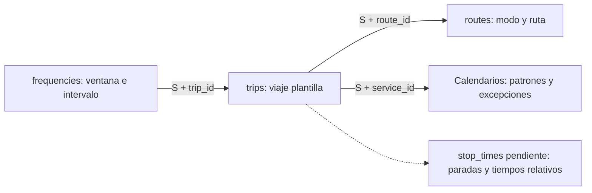

# Mi perfil de frequencies de 2025 y 2026

**Fecha:** 12 de noviembre de 2026. **Estado:** perfil de lectura completado y contrato implementado localmente.
Después de este perfil implementé frequencies_v1 y añadí su tarea a la plantilla. Su publicación en Databricks sigue pendiente.

## Alcance y evidencia

Después del cierre de trips comencé frequencies, orden 7 del plan.
Conservé nueve consultas correctas en el [notebook 16](../databricks/notebooks/silver/16_profile_gtfs_frequencies.ipynb).
Recuperé 77 filas estructuradas completas: 27 + 2 + 2 + 16 + 8 + 2 + 2 + 2 + 16.
Descarté una consulta inicial fallida que usaba nombres incorrectos de columnas de auditoría.
El notebook conserva solamente las consultas correctas.

| Versión | SHA-256 |
| --- | --- |
| 2025-10-28 | 07ba2ba9bb3b5bc1e38357355956757ce84fc68e6d05b74577bf017e189ab952 |
| 2026-09-29 | 08d14e0b3a5b9caa5451b722659871fd554e3273b94bdd770fdf81a26bf02097 |

Las consultas solo leen metadata, Bronze y dependencias Silver.
No modifiqué datos, Job ni Archify. No consulté stop_times.
Las lecturas no fijan versiones Delta ni una transacción conjunta.
Todavía no ejecuté el cuaderno completo como notebook.
Los filtros iniciales usan hashes. Comprobé las parejas versión/hash devueltas.
Los controles posteriores filtran las dos parejas explícitas.

## Qué representa una fila

Una fila define una ventana de frecuencia para un viaje plantilla.
Trip_id identifica la plantilla. Start_time indica inicio. End_time indica fin. Headway_secs indica el intervalo en segundos.
La [referencia GTFS](https://gtfs.org/documentation/schedule/reference/#frequenciestxt) define esos campos.

Como ejemplo real, cable_habil_2 publica 05:15:00–07:15:00 e intervalo de 10 segundos en 2026.
Ese registro describe frecuencia planificada. No demuestra una salida observada cada diez segundos.

S significa versión y hash juntos. No relaciono versiones distintas mediante un ID aislado.

## Resultados medidos

| Control | 2025-10-28 | 2026-09-29 |
| --- | ---: | ---: |
| Filas de frequencies | 2 | 14 |
| Trip_id distintos | 2 | 14 |
| Claves fuente distintas | 2 | 14 |
| Claves con inicio convertido distintas | 2 | 14 |
| Intervalos publicados, segundos | 60 | 10 y 16 |
| Menor inicio | 04:30:00 | 04:30:00 |
| Mayor fin | 22:00:00 | 22:15:00 |
| Duración mínima de ventana, segundos | 55.800 | 900 |
| Duración máxima de ventana, segundos | 63.000 | 55.800 |
| Rutas referenciadas | 1 | 1 |
| Servicios referenciados | 2 | 3 |
| Trazados referenciados | 1 | 1 |
| Referencias a trips sin resolver | 0 | 0 |
| Filas después del join con trips | 2 | 14 |

Los cuatro campos publicados tienen contenido en todas las filas.
No encontré nulos, vacíos, solo espacios, espacios extremos ni caracteres de control en esos campos.
No encontré errores de conversión, intervalos no positivos, ventanas invertidas, rutas de archivo incoherentes ni timestamps técnicos ausentes.
No encontré copias, conflictos de clave ni colisiones después de convertir la hora de inicio.
Los controles ejecutados no prueban la exactitud operativa del servicio.

## Contexto de negocio

Todas las ventanas corresponden a C_1 y route_type=6.
El estándar identifica ese modo como transporte por cable aéreo.
Los nombres publicados son TransmiCable en 2025 y CABLE en 2026.
No interpretaré estos intervalos como frecuencias de buses urbanos.

En 2025, service_id=7 activa lunes–sábado. Service_id=1 activa domingo.
Los dos patrones conservan intervalos fuente de 2000 a 2099.
En 2026, service_id=1 activa lunes–viernes; service_id=2 activa sábado; service_id=4 activa domingo.
Sus ventanas suman 6, 6 y 2 registros, respectivamente.
Las fechas fuente de esos patrones cubren 2026.
Las excepciones requieren calendar_dates. El nombre cable_festivo no prueba por sí solo las fechas festivas.

Cada ventana actual tiene un trip_id distinto.
El control de superposiciones por trip_id devuelve cero, igual que el control de ventanas contiguas por trip_id.
Eso no significa que las ventanas de la ruta estén separadas.
Al ordenar el contexto por ruta y servicio encontré once uniones de extremos entre viajes distintos en 2026.
Calculé ese diagnóstico independientemente sobre las 16 filas recuperadas. No cambia la identidad fuente.

No fusionaré viajes porque comparten ruta o calendario.
Tampoco deduciré crecimiento de red o mejoras operativas desde el cambio de 2 a 14 filas.
Los intervalos permanecen en segundos. No tengo evidencia para corregirlos como si fueran minutos.

## Exact_times y decisiones Silver

Ningún encabezado publica exact_times.
El estándar interpreta ausencia o vacío como servicio por frecuencia.
Conservaré null en el campo fuente propuesto. Source_columns conservará la ausencia del encabezado.
Propongo exact_times_effective=0 como derivación explícita del estándar.
No lo presentaré como un cero publicado por la fuente.

El [ejemplo oficial](https://gtfs.org/documentation/schedule/examples/frequencies/) explica cómo stop_times aporta tiempos relativos entre paradas.
Por ahora no expando salidas ni calculo vehículos requeridos.
La [contrato implementado](contracts/frequencies.md) define tipos, referencias y ventanas.
Los casos exact_times=1 tienen controles específicos de límite final y coherencia por viaje en el procesador implementado.

## Comprobación posterior de trips Silver

El bloque 3 recuperó 107.162 / 181.060 filas y la misma cantidad de trip_id distintos.
Ambos snapshots devuelven una sola versión de reglas: trips_v1.
Esta lectura comprueba disponibilidad y unicidad actuales. No vuelve a demostrar todos los controles del procesador.
Los joins de frequencies conservan 2 / 14 filas y cero referencias sin resolver.

## Verificación y siguiente paso

Contrasté las 16 filas fuente mediante un cálculo independiente.
Coincidieron claves, formatos, rangos, duraciones e intervalos con las consultas SQL.
También comprobé contenido Unicode y el contexto de las ventanas.
Ese contraste no constituye una suite de pruebas del futuro procesador.

Después de revisar el perfil implementé las reglas, las pruebas y una novena tarea con notebook 10.
La [guía de despliegue](silver_execution.md#despliegue-de-frequencies_v1) conserva los pasos. La primera publicación sigue pendiente.
La selección automática de snapshots sigue pendiente 8b.

## Implementación posterior al perfil

Implementé frequencies_v1 con Spark nativo y referencias a trips del mismo snapshot.
Las 42 pruebas seleccionadas pasaron sin omisiones. Incluyen trece nuevas y dos integraciones Delta en total.
Esas pruebas utilizan fixtures. No sustituyen los resultados medidos del perfil ni prueban una publicación en Workspace.
La [guía](silver_execution.md#despliegue-de-frequencies_v1) conserva el alcance y los pasos.
