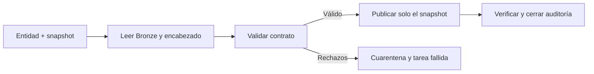

# Mi ejecución Silver por entidad y snapshot

**Estado actualizado al 10 de noviembre de 2026:** agency y routes están publicadas en Silver. Tras sincronizar el fix del lector ejecuté el Job ampliado y comprobé la existencia de las tablas. Esta confirmación corresponde a la ejecución que revisé durante el desarrollo; no es una nueva consulta de Silver hecha en el perfil de stops. Hoy completé el [perfil de stops](stops_profile_2025_2026.md) en lectura; su contrato implementado y publicación siguen pendientes.

## Mi recorrido habitual

Usaré [10_publish_gtfs_entity.ipynb](../databricks/notebooks/silver/10_publish_gtfs_entity.ipynb) como entrada única. En cada ejecución lee Bronze y el encabezado, aplica el contrato y publica el snapshot válido con auditoría. Los notebooks 08 y 09 quedan para aprendizaje y diagnóstico; no tengo que repetirlos manualmente antes de cada carga.



La publicación crea o actualiza estas tablas en mi catálogo y schema configurados:

| Tabla | Qué conserva |
| --- | --- |
| silver_gtfs_agency | Una agencia publicada por versión, hash e ID. |
| silver_gtfs_routes | Una ruta publicada por versión, hash e ID. |
| quarantine_gtfs_agency / quarantine_gtfs_routes | Rechazos por entidad, intento y snapshot, con contenido original, motivos y multiplicidad. |
| audit_gtfs_silver_runs | Una fila por intento y snapshot con RUNNING, SUCCEEDED, REJECTED o FAILED, conteos y marca de si Silver llegó a escribirse. |

No sustituiré toda la historia: el escritor usa [replaceWhere](https://docs.databricks.com/aws/en/delta/selective-overwrite) con versión y hash y comprueba el ámbito antes de escribir. Una salida Silver vacía o fuera del snapshot falla. No hay evolución automática de esquema.

Las tablas se escriben por separado. Si Silver se confirma y falla la etapa posterior, el intento termina FAILED con silver_committed=true. No haré rollback automático ni presentaré ese caso como una publicación completa. Antes de reintentar revisaré el motivo; la reconstrucción posterior sigue limitada al mismo snapshot.

## Corrección de la primera creación

Al ejecutar el bloque 2 del notebook 10 encontré `UNSUPPORTED_OPERATION: errorifexists is not supported`. La primera creación usaba una opción incompatible con mi entorno de Databricks. La cambié por `writeTo(...).using("delta").create()`, una operación de creación documentada por [Databricks](https://docs.databricks.com/aws/en/pyspark/reference/classes/dataframewriterv2). Si la tabla aparece por otra ejecución, la creación falla y conserva su contenido; las actualizaciones siguen usando `replaceWhere`.

Después de sincronizar módulos, reinicio Python si la sesión ya los importó y ejecuto desde el bloque 1. La versión actual del notebook tiene dos bloques. No borro tablas ni repito Bronze. Verifiqué la corrección con 14 pruebas de configuración y publicación en Linux con Spark 4.0.1 y Delta 4.0.0, incluida una creación concurrente simulada que conserva la tabla existente. Comprobé la corrección al publicar agency y ejecutar su Job en el workspace.

## Mi publicación por entidad

1. Sincronizo el repositorio completo y configuro las dependencias de requirements-silver.txt en el entorno del notebook o del Job. No dependo de instalaciones manuales hechas en otro notebook.
2. Elijo entity, feed_version y snapshot_sha256. El notebook 10 tiene dos bloques: parámetros/imports y ejecución completa.
3. Para routes necesito agency_v1 del mismo snapshot ya publicado. Puedo ejecutar mode=validate sin escribir o mode=publish para validar y publicar en una sola corrida.
4. Reviso el resumen: reconciled=true, rejected_rows=0, persisted=true y status=SUCCEEDED. El escritor ya verifica los datos después de publicarlos.
5. Solo en una revisión inicial o ante una incidencia consulto el histórico completo. Espero 7 + 7 en agency y, si routes pasa, 676 + 1.045 = 1.721 rutas. Una reejecución conserva los datos de negocio sin duplicarlos.

Puedo usar mode=validate para revisar sin escribir. No ejecuto el Job al mismo tiempo que una publicación manual. verify_history=true compara las otras versiones con una lectura Delta fijada antes de la escritura; lo mantengo para agency por su tamaño pequeño.

## Mi Job manual

La [plantilla JSON](../databricks/jobs/gtfs_bogota_silver_manual.template.json) define gtfs_bogota_silver_manual. La ruta /Workspace/REPO_ROOT es un marcador, no una ubicación real. El [generador](../databricks/gtfs_silver/job_config.py) la sustituye por la ruta que configure, sin guardar rutas personales o credenciales en Git.

El Job preparado tiene una etapa [For each](https://docs.databricks.com/aws/en/jobs/tasks/for-each) que recibe work_items y llama al notebook 10 una vez por entrada. Procesa agency de 2025 y 2026 y después otra etapa For each procesa routes. La segunda depende del éxito de la primera; ambas tienen concurrencia 1 y el Job admite una sola ejecución simultánea. Instala las dependencias una vez por entorno compatible; no encadena 08 → 09 → 10. No tiene horario ni trigger automático.

Puedo generarlo en PowerShell, con una ruta de Workspace real en lugar del marcador:

```powershell
python databricks/gtfs_silver/job_config.py --repo-root /Workspace/REPO_ROOT --environment-version 4 --output "$env:TEMP\gtfs_silver_job.json"
```

Elegiré una versión serverless disponible en mi workspace; 4 es el default de configuración, no una comprobación remota de disponibilidad. El notebook_path del JSON debe coincidir con el notebook de mi Git folder. Si lo importé con otro nombre o sin extensión, lo ajustaré al seleccionado en la UI.

Para crearlo desde la UI:

1. Creo un Job manual y configuro los parámetros catalog, schema, staging_volume, mode, verify_history y work_items con los valores del JSON generado.
2. Creo una tarea For each con Inputs = {{job.parameters.work_items}} y Concurrency = 1.
3. Su tarea interna es Notebook y selecciona 10_publish_gtfs_entity. Copio sus base_parameters del JSON; repo_root debe apuntar al repositorio completo.
4. Selecciono serverless y configuro las dependencias indicadas en environments. No instalo PySpark en Databricks.
5. Configuro máximo de ejecuciones simultáneas 1 y una política de reintento como la del JSON. Ejecuto manualmente y reviso el resultado y las tablas antes de añadir automatización por novedades Bronze.

Si dispongo de Databricks CLI autenticada, puedo usar la misma definición:

```powershell
databricks jobs create --json "@$env:TEMP\gtfs_silver_job.json"
```

Ese comando crea un Job nuevo: para mi Job existente necesito actualizar su configuración, no crear otro duplicado. La integración Genie permite consultas, pero no expone creación o edición de Jobs. No tengo CLI autenticada y la consola no admite control automatizado. Creé y ejecuté el Job de agency manualmente; después apliqué y ejecuté la ampliación agency → routes en Workspace. Las próximas entidades aún requieren contrato e integración antes de añadir tareas.

## Cómo incorporo routes al Job que ya funciona

Conservo la etapa actual de agency. Añado otra tarea For each llamada publish_routes y la hago depender de la primera con condición de éxito. Si antes de routes falla agency, la segunda etapa queda bloqueada.

En Inputs puedo usar directamente esta lista, igual que en el Job manual que ya configuré. Así evito confundir parámetros de tarea con parámetros generales:

```json
[
  {"entity":"routes","feed_version":"2025-10-28","snapshot_sha256":"07ba2ba9bb3b5bc1e38357355956757ce84fc68e6d05b74577bf017e189ab952"},
  {"entity":"routes","feed_version":"2026-09-29","snapshot_sha256":"08d14e0b3a5b9caa5451b722659871fd554e3273b94bdd770fdf81a26bf02097"}
]
```

La tarea interna process_routes_snapshot selecciona el mismo notebook 10 y el entorno con las mismas dependencias. Reutilizo repo_root, catalog, schema, staging_volume, mode y verify_history de agency; los tres parámetros variables son entity={{input.entity}}, feed_version={{input.feed_version}} y snapshot_sha256={{input.snapshot_sha256}}. Las rutas personales se configuran solo en Workspace. No añado otra tarea Notebook suelta antes del ciclo.

En la definición generada uso el parámetro general routes_work_items como fuente de esa lista; es equivalente a pegarla directamente en Inputs. Mantengo concurrencia 1 en cada ciclo y máximo una ejecución del Job. El notebook no instala paquetes ni reinicia Python por iteración: las dependencias pertenecen al entorno. Conservé su entorno 6 ya usado en Workspace y reemplacé la referencia personal a requirements-silver.txt por los dos paquetes fijados en sus metadatos. El Job generado también declara esos paquetes; puede usar otra versión de entorno disponible mediante --environment-version.

## Qué simplifiqué respecto a agency

- Reutilizo un notebook y un escritor: cada entidad aporta su contrato, no una copia del pipeline.
- El perfil inicial queda como SQL e informe; no creo notebooks 08 y 09 adicionales para routes ni los exijo en cada corrida.
- Routes valida, tipa, cruza y deduplica en Spark, sin UDFs ni descargar filas al driver. Solo recupero agregados pequeños.
- Uno los controles de vacío y ámbito del escritor en una agregación y los de clave/conteo en otra. La comparación bidireccional se ejecuta con una sola acción Spark.
- Retiro tres celdas de preparación (instalación y dos reinicios) y el antiguo bloque 3, que contaba otra vez toda la historia en cada iteración. El resumen de publicación ya confirma la lectura posterior.
- Fijo las versiones Delta de entrada para no releer estados distintos al recalcular un plan.

No afirmo una reducción de segundos sin medir el Job ampliado. Evito cache/persist obligatorio: el entorno 4 preparado no cumple los requisitos actuales del [caché serverless](https://docs.databricks.com/aws/en/compute/serverless/dataframe-cache), que requiere versión 5 o superior y preview habilitada. Las acciones pueden recalcular expresiones, pero leen entradas fijadas. Mediré el plan y el costo antes de introducir caché o materializaciones adicionales.

Para una revisión puntual puedo consultar:

```sql
select source_feed_version, source_sha256, count(*) as rows
from workspace.gtfs_bogota.silver_gtfs_routes
 group by source_feed_version, source_sha256
 order by source_feed_version, source_sha256;
```

## Cómo reduciré el trabajo para las demás tablas

El [registro de entidades](../databricks/config/silver_entities.json) habilita agency y routes. Routes depende de agency; el Job aplica esa dependencia y el pipeline comprueba su snapshot incluso si ejecuto routes manualmente. Reutilizaré parámetros, ejecución por snapshot, escritura por ámbito y auditoría. Añadiré cada entidad con su contrato y procesador específico antes de habilitarla; cambiar un nombre de tabla no crea automáticamente sus reglas.

Con nueve o cien tablas, separaré el trabajo que se hace una vez de lo que corre siempre:

- Una vez por entidad: grano, clave, tipos, reglas y dependencias.
- En cada corrida: perfil y validación automáticos, publicación, métricas y estado.
- Revisión manual: errores nuevos, cambios de esquema y decisiones de negocio; no copiar todas las salidas sanas al chat.

Respetaré un grafo de dependencias: agency antes de routes; rutas, servicios y geometrías antes de trips; trips y stops antes de stop_times. Las ramas independientes podrán ejecutarse en paralelo cuando mida el cómputo. Un fallo de una entidad bloqueará a sus dependientes.

Para cien entidades usaré un archivo o tabla de control y entradas compactas. For each admite referencias a parámetros y task values, pero no es una solución a dependencias arbitrarias ni a listas ilimitadas. No crearé cien notebooks copiados ni meteré cien tablas grandes al driver: el límite de 1.000 filas y la validación Python son exclusivos de agency. Routes usa Spark sin collect de sus registros.

## Qué comprobé

Ejecuté 64 pruebas sin omisiones en un contenedor Linux con Apache Spark 4.0.1 y Delta 4.0.0, usando únicamente fixtures sintéticos y repositorio montado como lectura. Pasaron los seis tests nativos anteriores de perfilado/adaptación y los seis nuevos de publicación, junto a los demás controles.

Probé coexistencia de 2025 y 2026, reejecución sin duplicación, dos hashes con la misma fecha, bloqueo de salidas vacías o fuera de ámbito, cuarentena con motivos y multiplicidad, modo de lectura sin tablas y fallos posteriores a un commit. La auditoría distingue esos fallos de un rechazo previo a escribir.

La preparación de librerías ocurre fuera de la suite. Para repetir todas las pruebas en Linux necesito las dependencias de requirements-silver.txt, PySpark 4.0.1 y los JARs locales delta-spark_2.13 4.0.0 y delta-storage 4.0.0. Configuro GTFS_DELTA_TEST_JARS con ambos archivos separados por coma y PYSPARK_SUBMIT_ARGS con --jars y esa misma lista, y ejecuto python -B -m unittest discover -s tests -v. Los tests no descargan JARs ni llaman a servicios externos. Sin ese entorno, los casos nativos quedan omitidos y no deben contarse como aprobados.

La primera prueba nativa en Windows no pudo iniciar Spark por faltar componentes Hadoop. La comprobación válida se realizó después en Linux. Estas pruebas históricas se complementaron después con la publicación y el Job de agency en Workspace. Las pruebas de routes se documentan aparte. Posteriormente ejecuté el Job ampliado y comprobé las tablas Silver; esa confirmación complementa las pruebas locales.


## Verificación de routes_v1

Ejecuté la suite completa en Linux con Spark 4.0.1 y Delta 4.0.0: **75 pruebas aprobadas, sin omisiones**. Después añadí y ejecuté tres pruebas sin IO del despacho del pipeline: también pasaron. Son 78 comprobaciones aprobadas en total; las tres últimas no requieren Spark.

Las pruebas cubren los controles anteriores de Bronze y agency, tipos de routes, 1.045 registros sintéticos sin límite de driver, nombres opcionales, formatos inválidos, procedencia, duplicados y conflictos, dependencias ausentes o de otro snapshot, publicación de ambas versiones, reintentos, cuarentena y conservación de Silver ante rechazos. No son mediciones de rendimiento del Job real ni una ejecución remota de routes.


## Corrección del nombre de tabla al leer versiones Delta

Al ejecutar el Job ampliado encontré un ValueError antes de validar agency: estaba pasando nombres con backticks desde pipeline.py a _versioned_table, que vuelve a validar y entrecomillar cada parte. El mismo defecto afectaba a la dependencia agency de routes.

Conservo los nombres como catálogo.schema.tabla dentro del pipeline y aplico quoted_table solo al consultar tableExists. _versioned_table recibe el nombre plano y lo entrecomilla una sola vez. No relajo la validación de identificadores ni cambio las reglas de datos.

Reproduje el fallo con las pruebas de despacho usando el lector real; antes lo sustituían y no detectaban el error. Añadí además una prueba con Bronze, Silver agency y Silver routes Delta reales, simulando únicamente la lectura del encabezado Staging. Esta prueba recorre run_entity y comprueba un reintento sin duplicación.

Para desplegar sincronizo la corrección con Pull y reparo la ejecución fallida desde Runs → Repair run. Reviso que incluya agency y la etapa routes dependiente que quedó sin ejecutar. El fallo de nombres ocurre antes de la publicación de ese intento; los snapshots ya publicados en ejecuciones anteriores permanecen disponibles. Después de sincronizar la corrección ejecuté el flujo y comprobé la existencia de las tablas Silver; la recuperación ya quedó confirmada durante el desarrollo.

**Validación de este fix:** las tres pruebas de despacho pasaron después de reproducir el fallo anterior. También pasó la nueva prueba de integración con Spark 4.0.1 y Delta 4.0.0: ejecuté run_entity para agency y routes sobre tablas Delta sintéticas y repetí routes sin duplicar registros. Simulé únicamente los encabezados Staging. Después confirmé la ejecución del Job real y la existencia de las tablas Silver. No confundo esa evidencia de ejecución con la prueba de integración sintética.


## Mi siguiente despliegue: stops_v1

Implementé stops con Spark nativo y el mismo escritor de agency/routes. El procesador está habilitado en el registro local, pero todavía no ejecuté su validación o publicación en Databricks. Primero comprobaré los resultados de las pruebas; después sincronizaré el repositorio y seguiré estos pasos con el Job detenido:

1. En el notebook 10 configuro entity=stops, mode=validate y el par versión/hash de 2025. Ejecuto desde el bloque 1. Espero 6.530 candidatos, cero rechazos y 27 nombres normalizados si el origen sigue coincidiendo con el perfil. No espero que las cuatro ausencias de stop_code causen rechazos.
2. Repito con el par de 2026. Espero 8.314 candidatos, cero rechazos, un nombre normalizado y 12 estaciones sin hijos referenciados. Las advertencias pueden coexistir en una misma fila; warning_rows no es la suma de los dos motivos.
3. Reviso reconciled=true, ready_for_publication=true, name_trimmed_rows, stations_without_children y warning_rows. El modo validate no modifica tablas. Si hay rechazos, reviso el cambio respecto del perfil antes de publicar.
4. Cambio a mode=publish para cada snapshot y compruebo persisted=true y status=SUCCEEDED. La salida será silver_gtfs_stops, con 17 columnas. La cuarentena y auditoría usan el escritor existente. No repito Bronze.
5. Amplío el Job existente con stops_work_items y publish_stops a partir de la plantilla, conservando las tareas agency/routes. La dependencia de publish_stops respecto de publish_routes sirve para serializar escrituras sobre la auditoría común; no representa una clave foránea entre esas tablas.
6. Después de la primera publicación compruebo una reejecución: el ámbito de versión + hash se reconstruye sin añadir copias ni cambiar los demás snapshots. Cualquier fallo con silver_committed=true se revisa antes del reintento.

Los dos elementos para stops_work_items son:

```json
[
  {"entity": "stops", "feed_version": "2025-10-28", "snapshot_sha256": "07ba2ba9bb3b5bc1e38357355956757ce84fc68e6d05b74577bf017e189ab952"},
  {"entity": "stops", "feed_version": "2026-09-29", "snapshot_sha256": "08d14e0b3a5b9caa5451b722659871fd554e3273b94bdd770fdf81a26bf02097"}
]
```

En la tarea interna uso el mismo notebook 10 y los mismos parámetros por input que en agency/routes. No añado 11_profile_gtfs_stops al Job: es evidencia de lectura. Si la sesión interactiva ya importó módulos anteriores al Pull, reinicio Python y comienzo de nuevo por el bloque 1; los Jobs deben usar el repositorio sincronizado.

El [contrato stops_v1](contracts/stops.md) detalla las reglas. La normalización solo limpia los bordes Unicode de stop_name; las claves se conservan. Las estaciones sin hijos y el par geográfico (0, 0) producen advertencias para revisión; los errores de identidad, conversión, procedencia y jerarquía bloquean el snapshot completo. No añado librerías de producción ni columnas a la auditoría existente.

### Qué cambió en los archivos Python

stops_spark.py contiene las reglas de ubicaciones, coordenadas, nombres y padres. spark_validation.py reúne la preparación de Bronze y la reconciliación de filas/copias que ahora comparten routes y stops; no contiene una regla que limpie nombres de routes. Cada entidad sigue definiendo sus propias reglas y expresiones de salida.

pipeline.py selecciona el procesador, publication.py conserva la escritura común y job_config.py prepara las tres tareas seriales. El notebook 10 es la entrada de ejecución y no duplica esas funciones. No cambié los tipos ni la política de nombres de agency/routes.

### Verificación local de esta ampliación

El 10 de noviembre de 2026 pasaron las **91 pruebas de la suite completa, sin omisiones**, en un entorno Linux aislado con Python 3.12, Java 17, Spark 4.0.1 y Delta 4.0.0. Incluyen las regresiones de agency/routes, los cuatro recorridos de despacho y las reglas de stops: tipos, ausencias, limpieza Unicode, conflictos, jerarquía y más de 1.000 ubicaciones.

La integración de stops leyó tablas Delta de prueba mediante el pipeline real, publicó dos snapshots, reejecutó uno sin duplicados y rechazó una entrada inválida dejando Silver intacta y registrando sus dos filas fuente en cuarentena. Sustituí únicamente la lectura del encabezado Staging por un encabezado de fixture; los datos eran sintéticos. La compilación también pasó. Esta evidencia comprueba el código local; la validación y publicación de stops en Databricks siguen pendientes. No medí todavía el tiempo del Job ampliado en Free Edition.
