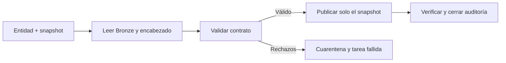

# Mi ejecución Silver por entidad y snapshot

**Estado al 6 de noviembre de 2026:** ejecuté y revisé el notebook 09 para agency de 2025 y 2026 en Databricks: siete candidatos y cero rechazos en cada uno. Preparé la publicación, cuarentena, auditoría y configuración del Job. La suite local con Spark y Delta reales pasó 64 pruebas. Todavía no he creado el Job ni ejecutado escrituras Silver en el workspace.

## Mi recorrido habitual

Usaré [10_publish_gtfs_entity.ipynb](../databricks/notebooks/silver/10_publish_gtfs_entity.ipynb) como entrada única. En cada ejecución lee Bronze y el encabezado, aplica el contrato y publica el snapshot válido con auditoría. Los notebooks 08 y 09 quedan para aprendizaje y diagnóstico; no tengo que repetirlos manualmente antes de cada carga.



La publicación crea o actualiza estas tablas en mi catálogo y schema configurados:

| Tabla | Qué conserva |
| --- | --- |
| silver_gtfs_agency | Una agencia publicada por versión, hash e ID. |
| quarantine_gtfs_agency | Rechazos por intento y snapshot, con contenido original, motivos y multiplicidad. |
| audit_gtfs_silver_runs | Una fila por intento y snapshot con RUNNING, SUCCEEDED, REJECTED o FAILED, conteos y marca de si Silver llegó a escribirse. |

No sustituiré toda la historia: el escritor usa [replaceWhere](https://docs.databricks.com/aws/en/delta/selective-overwrite) con versión y hash y comprueba el ámbito antes de escribir. Una salida Silver vacía o fuera del snapshot falla. No hay evolución automática de esquema.

Las tablas se escriben por separado. Si Silver se confirma y falla la etapa posterior, el intento termina FAILED con silver_committed=true. No haré rollback automático ni presentaré ese caso como una publicación completa. Antes de reintentar revisaré el motivo; la reconstrucción posterior sigue limitada al mismo snapshot.

## Corrección de la primera creación

Al ejecutar el bloque 2 del notebook 10 encontré `UNSUPPORTED_OPERATION: errorifexists is not supported`. La primera creación usaba una opción incompatible con mi entorno de Databricks. La cambié por `writeTo(...).using("delta").create()`, una operación de creación documentada por [Databricks](https://docs.databricks.com/aws/en/pyspark/reference/classes/dataframewriterv2). Si la tabla aparece por otra ejecución, la creación falla y conserva su contenido; las actualizaciones siguen usando `replaceWhere`.

Después de sincronizar el módulo corregido, reinicio Python y ejecuto los bloques 1 → 2 → 3. No borro tablas ni repito Bronze. Verifiqué la corrección con 14 pruebas de configuración y publicación en Linux con Spark 4.0.1 y Delta 4.0.0, incluida una creación concurrente simulada que conserva la tabla existente. Todavía debo comprobar el resultado en el workspace.

## Mi primera publicación

1. Sincronizo el repositorio completo, incluidos gtfs_silver, config y el notebook 10. Instalo databricks/requirements-silver.txt también en el entorno del notebook 10 y reinicio Python antes del bloque 1; la instalación del notebook 09 no se comparte automáticamente.
2. Ejecuto 10 con entity=agency, el snapshot 2025 y mode=publish. El catálogo y schema deben existir.
3. Ejecuto 10 con el snapshot 2026, cambiando versión y hash juntos.
4. Compruebo siete filas por snapshot y catorce históricas.
5. Repito una versión: mantengo las catorce filas y los mismos valores de negocio. El ID y timestamp del intento pueden cambiar.

Puedo usar mode=validate para revisar sin escribir. No ejecuto el Job al mismo tiempo que una publicación manual. verify_history=true compara las otras versiones con una lectura Delta fijada antes de la escritura; lo mantengo para agency por su tamaño pequeño.

## Mi Job manual

La [plantilla JSON](../databricks/jobs/gtfs_bogota_silver_manual.template.json) define gtfs_bogota_silver_manual. La ruta /Workspace/REPO_ROOT es un marcador, no una ubicación real. El [generador](../databricks/gtfs_silver/job_config.py) la sustituye por la ruta que configure, sin guardar rutas personales o credenciales en Git.

El Job tiene una tarea [For each](https://docs.databricks.com/aws/en/jobs/tasks/for-each) que recibe work_items y llama al notebook 10 una vez por entrada. Empieza con agency de 2025 y 2026, concurrencia 1 y una sola ejecución del Job a la vez. Instala las dependencias una vez por entorno compatible; no encadena 08 → 09 → 10. No tiene horario ni trigger automático.

Puedo generarlo en PowerShell, con una ruta de Workspace real en lugar del marcador:

```powershell
python databricks/gtfs_silver/job_config.py --repo-root /Workspace/REPO_ROOT --environment-version 4 --output "$env:TEMP\gtfs_silver_job.json"
```

Elegiré una versión serverless disponible en mi workspace; 4 es el default de configuración, no una comprobación remota de disponibilidad. El notebook_path del JSON debe coincidir con el notebook de mi Git folder. Si lo importé con otro nombre o sin extensión, lo ajustaré al seleccionado en la UI.

Para crearlo desde la UI:

1. Creo un Job manual y configuro los parámetros catalog, schema, staging_volume, mode, verify_history y work_items con los valores del JSON generado.
2. Creo una tarea For each con Inputs = {{job.parameters.work_items}} y Concurrency = 1.
3. Su tarea interna es Notebook y selecciona 10_publish_gtfs_entity. Copio sus base_parameters del JSON; repo_root debe apuntar al repositorio completo.
4. Selecciono serverless y configuro las dependencias indicadas en environments. No instalo PySpark en Databricks.
5. Configuro máximo de ejecuciones simultáneas 1 y una política de reintento como la del JSON. Ejecuto manualmente y reviso el resultado y las tablas antes de añadir automatización por novedades Bronze.

Si dispongo de Databricks CLI autenticada, puedo usar la misma definición:

```powershell
databricks jobs create --json "@$env:TEMP\gtfs_silver_job.json"
```

Ese comando crea un Job nuevo: no lo repetiré como si fuera una actualización. La creación, los permisos y una ejecución de prueba en Free Edition siguen pendientes. La integración Genie conectada permite consultas, pero no expone creación de Jobs. No tengo un perfil CLI local autenticado; no interpreto la conexión Genie como esa autenticación. Comprobé la carpeta del proyecto desde el navegador conectado, pero la consola mostró un aviso de que no admite control automatizado y pide continuar manualmente o con Genie One MCP. Detuve la interacción sin crear Jobs ni publicar datos. La raíz de Workspace ya quedó identificada y generé el JSON con la ruta real fuera de Git; todavía falta sincronizar el notebook 10 y crear el Job por una vía admitida.

## Cómo reduciré el trabajo para las demás tablas

El [registro de entidades](../databricks/config/silver_entities.json) habilita por ahora solo agency. Reutilizaré parámetros, ejecución por snapshot, escritura por ámbito y auditoría. Añadiré cada entidad con su contrato y procesador específico antes de habilitarla; cambiar un nombre de tabla no crea automáticamente sus reglas.

Con nueve o cien tablas, separaré el trabajo que se hace una vez de lo que corre siempre:

- Una vez por entidad: grano, clave, tipos, reglas y dependencias.
- En cada corrida: perfil y validación automáticos, publicación, métricas y estado.
- Revisión manual: errores nuevos, cambios de esquema y decisiones de negocio; no copiar todas las salidas sanas al chat.

Respetaré un grafo de dependencias: agency antes de routes; rutas, servicios y geometrías antes de trips; trips y stops antes de stop_times. Las ramas independientes podrán ejecutarse en paralelo cuando mida el cómputo. Un fallo de una entidad bloqueará a sus dependientes.

Para cien entidades usaré un archivo o tabla de control y entradas compactas. For each admite referencias a parámetros y task values, pero no es una solución a dependencias arbitrarias ni a listas ilimitadas. No crearé cien notebooks copiados ni meteré cien tablas grandes al driver: el límite de 1.000 filas y la validación Python actual son exclusivos de agency.

## Qué comprobé

Ejecuté 64 pruebas sin omisiones en un contenedor Linux con Apache Spark 4.0.1 y Delta 4.0.0, usando únicamente fixtures sintéticos y repositorio montado como lectura. Pasaron los seis tests nativos anteriores de perfilado/adaptación y los seis nuevos de publicación, junto a los demás controles.

Probé coexistencia de 2025 y 2026, reejecución sin duplicación, dos hashes con la misma fecha, bloqueo de salidas vacías o fuera de ámbito, cuarentena con motivos y multiplicidad, modo de lectura sin tablas y fallos posteriores a un commit. La auditoría distingue esos fallos de un rechazo previo a escribir.

La preparación de librerías ocurre fuera de la suite. Para repetir todas las pruebas en Linux necesito las dependencias de requirements-silver.txt, PySpark 4.0.1 y los JARs locales delta-spark_2.13 4.0.0 y delta-storage 4.0.0. Configuro GTFS_DELTA_TEST_JARS con ambos archivos separados por coma y PYSPARK_SUBMIT_ARGS con --jars y esa misma lista, y ejecuto python -B -m unittest discover -s tests -v. Los tests no descargan JARs ni llaman a servicios externos. Sin ese entorno, los casos nativos quedan omitidos y no deben contarse como aprobados.

La primera prueba nativa en Windows no pudo iniciar Spark por faltar componentes Hadoop. La comprobación válida se realizó después en Linux. Esto no demuestra aún la ejecución del Job, las autorizaciones de Unity Catalog ni la publicación en el workspace.
