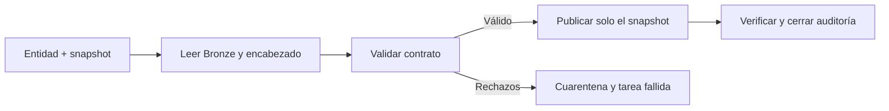

# Mi ejecución Silver por entidad y snapshot

**Estado actualizado al 11 de noviembre de 2026:** agency, routes, stops, calendar, calendar_dates y service_dates están publicadas en Silver; service_dates está comprobada para el horizonte anual 2026. Ejecuté el Job ampliado y comprobé las tablas; para stops también consulté sus datos. El [cierre de ejecución](#cierre-de-la-ejecución-de-stops) distingue esta comprobación de los conteos del perfil fuente y de las pruebas locales. Ejecuté las dos tareas nuevas de calendarios y comprobé sus tablas y datos; también publiqué service_dates para 2026 y comprobé sus datos; el siguiente paso del plan es shape_points.

## Mi recorrido habitual

Usaré [10_publish_gtfs_entity.ipynb](../databricks/notebooks/silver/10_publish_gtfs_entity.ipynb) como entrada única. En cada ejecución lee Bronze y el encabezado, aplica el contrato y publica el snapshot válido con auditoría. Los notebooks 08 y 09 quedan para aprendizaje y diagnóstico; no tengo que repetirlos manualmente antes de cada carga.



La publicación crea o actualiza estas tablas en mi catálogo y schema configurados:

| Tabla | Qué conserva |
| --- | --- |
| silver_gtfs_agency | Una agencia publicada por versión, hash e ID. |
| silver_gtfs_routes | Una ruta publicada por versión, hash e ID. |
| quarantine_gtfs_agency / quarantine_gtfs_routes | Rechazos por entidad, intento y snapshot, con contenido original, motivos y multiplicidad. |
| audit_gtfs_silver_runs | Una fila por intento y snapshot con RUNNING, SUCCEEDED, REJECTED o FAILED, conteos y marca de si Silver llegó a escribirse. |

No sustituiré toda la historia: el escritor usa [replaceWhere](https://docs.databricks.com/aws/en/delta/selective-overwrite) con versión y hash y comprueba el ámbito antes de escribir. Una salida Silver vacía o fuera del snapshot falla. No hay evolución automática de esquema.

Las tablas se escriben por separado. Si Silver se confirma y falla la etapa posterior, el intento termina FAILED con silver_committed=true. No haré rollback automático ni presentaré ese caso como una publicación completa. Antes de reintentar revisaré el motivo; la reconstrucción posterior sigue limitada al mismo snapshot.

## Corrección de la primera creación

Al ejecutar el bloque 2 del notebook 10 encontré `UNSUPPORTED_OPERATION: errorifexists is not supported`. La primera creación usaba una opción incompatible con mi entorno de Databricks. La cambié por `writeTo(...).using("delta").create()`, una operación de creación documentada por [Databricks](https://docs.databricks.com/aws/en/pyspark/reference/classes/dataframewriterv2). Si la tabla aparece por otra ejecución, la creación falla y conserva su contenido; las actualizaciones siguen usando `replaceWhere`.

Después de sincronizar módulos, reinicio Python si la sesión ya los importó y ejecuto desde el bloque 1. La versión actual del notebook tiene dos bloques. No borro tablas ni repito Bronze. Verifiqué la corrección con 14 pruebas de configuración y publicación en Linux con Spark 4.0.1 y Delta 4.0.0, incluida una creación concurrente simulada que conserva la tabla existente. Comprobé la corrección al publicar agency y ejecutar su Job en el workspace.

## Mi publicación por entidad

1. Sincronizo el repositorio completo y configuro las dependencias de requirements-silver.txt en el entorno del notebook o del Job. No dependo de instalaciones manuales hechas en otro notebook.
2. Elijo entity, feed_version y snapshot_sha256. El notebook 10 tiene dos bloques: parámetros/imports y ejecución completa.
3. Para routes necesito agency_v1 del mismo snapshot ya publicado. Puedo ejecutar mode=validate sin escribir o mode=publish para validar y publicar en una sola corrida.
4. Reviso el resumen: reconciled=true, rejected_rows=0, persisted=true y status=SUCCEEDED. El escritor ya verifica los datos después de publicarlos.
5. Solo en una revisión inicial o ante una incidencia consulto el histórico completo. Espero 7 + 7 en agency y, si routes pasa, 676 + 1.045 = 1.721 rutas. Una reejecución conserva los datos de negocio sin duplicarlos.

Puedo usar mode=validate para revisar sin escribir. No ejecuto el Job al mismo tiempo que una publicación manual. verify_history=true compara las otras versiones con una lectura Delta fijada antes de la escritura; lo mantengo para agency por su tamaño pequeño.

## Mi Job manual

La [plantilla JSON](../databricks/jobs/gtfs_bogota_silver_manual.template.json) define gtfs_bogota_silver_manual. La ruta /Workspace/REPO_ROOT es un marcador, no una ubicación real. El [generador](../databricks/gtfs_silver/job_config.py) la sustituye por la ruta que configure, sin guardar rutas personales o credenciales en Git.

El Job preparado tiene una etapa [For each](https://docs.databricks.com/aws/en/jobs/tasks/for-each) que recibe work_items y llama al notebook 10 una vez por entrada. Procesa agency de 2025 y 2026 y después otra etapa For each procesa routes. La segunda depende del éxito de la primera; ambas tienen concurrencia 1 y el Job admite una sola ejecución simultánea. Instala las dependencias una vez por entorno compatible; no encadena 08 → 09 → 10. No tiene horario ni trigger automático.

Puedo generarlo en PowerShell, con una ruta de Workspace real en lugar del marcador:

```powershell
python databricks/gtfs_silver/job_config.py --repo-root /Workspace/REPO_ROOT --environment-version 4 --output "$env:TEMP\gtfs_silver_job.json"
```

Elegiré una versión serverless disponible en mi workspace; 4 es el default de configuración, no una comprobación remota de disponibilidad. El notebook_path del JSON debe coincidir con el notebook de mi Git folder. Si lo importé con otro nombre o sin extensión, lo ajustaré al seleccionado en la UI.

Para crearlo desde la UI:

1. Creo un Job manual y configuro los parámetros catalog, schema, staging_volume, mode, verify_history y work_items con los valores del JSON generado.
2. Creo una tarea For each con Inputs = {{job.parameters.work_items}} y Concurrency = 1.
3. Su tarea interna es Notebook y selecciona 10_publish_gtfs_entity. Copio sus base_parameters del JSON; repo_root debe apuntar al repositorio completo.
4. Selecciono serverless y configuro las dependencias indicadas en environments. No instalo PySpark en Databricks.
5. Configuro máximo de ejecuciones simultáneas 1 y una política de reintento como la del JSON. Ejecuto manualmente y reviso el resultado y las tablas antes de añadir automatización por novedades Bronze.

Si dispongo de Databricks CLI autenticada, puedo usar la misma definición:

```powershell
databricks jobs create --json "@$env:TEMP\gtfs_silver_job.json"
```

Ese comando crea un Job nuevo: para mi Job existente necesito actualizar su configuración, no crear otro duplicado. La integración Genie permite consultas, pero no expone creación o edición de Jobs. No tengo CLI autenticada y la consola no admite control automatizado. Creé y ejecuté el Job de agency manualmente; después apliqué y ejecuté la ampliación agency → routes en Workspace. Las próximas entidades aún requieren contrato e integración antes de añadir tareas.

## Cómo incorporo routes al Job que ya funciona

Conservo la etapa actual de agency. Añado otra tarea For each llamada publish_routes y la hago depender de la primera con condición de éxito. Si antes de routes falla agency, la segunda etapa queda bloqueada.

En Inputs puedo usar directamente esta lista, igual que en el Job manual que ya configuré. Así evito confundir parámetros de tarea con parámetros generales:

```json
[
  {"entity":"routes","feed_version":"2025-10-28","snapshot_sha256":"07ba2ba9bb3b5bc1e38357355956757ce84fc68e6d05b74577bf017e189ab952"},
  {"entity":"routes","feed_version":"2026-09-29","snapshot_sha256":"08d14e0b3a5b9caa5451b722659871fd554e3273b94bdd770fdf81a26bf02097"}
]
```

La tarea interna process_routes_snapshot selecciona el mismo notebook 10 y el entorno con las mismas dependencias. Reutilizo repo_root, catalog, schema, staging_volume, mode y verify_history de agency; los tres parámetros variables son entity={{input.entity}}, feed_version={{input.feed_version}} y snapshot_sha256={{input.snapshot_sha256}}. Las rutas personales se configuran solo en Workspace. No añado otra tarea Notebook suelta antes del ciclo.

En la definición generada uso el parámetro general routes_work_items como fuente de esa lista; es equivalente a pegarla directamente en Inputs. Mantengo concurrencia 1 en cada ciclo y máximo una ejecución del Job. El notebook no instala paquetes ni reinicia Python por iteración: las dependencias pertenecen al entorno. Conservé su entorno 6 ya usado en Workspace y reemplacé la referencia personal a requirements-silver.txt por los dos paquetes fijados en sus metadatos. El Job generado también declara esos paquetes; puede usar otra versión de entorno disponible mediante --environment-version.

## Qué simplifiqué respecto a agency

- Reutilizo un notebook y un escritor: cada entidad aporta su contrato, no una copia del pipeline.
- El perfil inicial queda como SQL e informe; no creo notebooks 08 y 09 adicionales para routes ni los exijo en cada corrida.
- Routes valida, tipa, cruza y deduplica en Spark, sin UDFs ni descargar filas al driver. Solo recupero agregados pequeños.
- Uno los controles de vacío y ámbito del escritor en una agregación y los de clave/conteo en otra. La comparación bidireccional se ejecuta con una sola acción Spark.
- Retiro tres celdas de preparación (instalación y dos reinicios) y el antiguo bloque 3, que contaba otra vez toda la historia en cada iteración. El resumen de publicación ya confirma la lectura posterior.
- Fijo las versiones Delta de entrada para no releer estados distintos al recalcular un plan.

No afirmo una reducción de segundos sin medir el Job ampliado. Evito cache/persist obligatorio: el entorno 4 preparado no cumple los requisitos actuales del [caché serverless](https://docs.databricks.com/aws/en/compute/serverless/dataframe-cache), que requiere versión 5 o superior y preview habilitada. Las acciones pueden recalcular expresiones, pero leen entradas fijadas. Mediré el plan y el costo antes de introducir caché o materializaciones adicionales.

Para una revisión puntual puedo consultar:

```sql
select source_feed_version, source_sha256, count(*) as rows
from workspace.gtfs_bogota.silver_gtfs_routes
 group by source_feed_version, source_sha256
 order by source_feed_version, source_sha256;
```

## Cómo reduciré el trabajo para las demás tablas

El [registro de entidades](../databricks/config/silver_entities.json) habilita agency, routes, stops, calendar y calendar_dates. Routes depende de agency; calendar_dates requiere calendar del mismo snapshot cuando el archivo semanal está publicado. El detalle de calendarios está en su sección de despliegue. Para routes, el Job aplica esa dependencia y el pipeline comprueba su snapshot incluso si ejecuto routes manualmente. Reutilizaré parámetros, ejecución por snapshot, escritura por ámbito y auditoría. Añadiré cada entidad con su contrato y procesador específico antes de habilitarla; cambiar un nombre de tabla no crea automáticamente sus reglas.

Con nueve o cien tablas, separaré el trabajo que se hace una vez de lo que corre siempre:

- Una vez por entidad: grano, clave, tipos, reglas y dependencias.
- En cada corrida: perfil y validación automáticos, publicación, métricas y estado.
- Revisión manual: errores nuevos, cambios de esquema y decisiones de negocio; no copiar todas las salidas sanas al chat.

Respetaré un grafo de dependencias: agency antes de routes; rutas, servicios y geometrías antes de trips; trips y stops antes de stop_times. Las ramas independientes podrán ejecutarse en paralelo cuando mida el cómputo. Un fallo de una entidad bloqueará a sus dependientes.

Para cien entidades usaré un archivo o tabla de control y entradas compactas. For each admite referencias a parámetros y task values, pero no es una solución a dependencias arbitrarias ni a listas ilimitadas. No crearé cien notebooks copiados ni meteré cien tablas grandes al driver: el límite de 1.000 filas y la validación Python son exclusivos de agency. Routes usa Spark sin collect de sus registros.

## Qué comprobé

Ejecuté 64 pruebas sin omisiones en un contenedor Linux con Apache Spark 4.0.1 y Delta 4.0.0, usando únicamente fixtures sintéticos y repositorio montado como lectura. Pasaron los seis tests nativos anteriores de perfilado/adaptación y los seis nuevos de publicación, junto a los demás controles.

Probé coexistencia de 2025 y 2026, reejecución sin duplicación, dos hashes con la misma fecha, bloqueo de salidas vacías o fuera de ámbito, cuarentena con motivos y multiplicidad, modo de lectura sin tablas y fallos posteriores a un commit. La auditoría distingue esos fallos de un rechazo previo a escribir.

La preparación de librerías ocurre fuera de la suite. Para repetir todas las pruebas en Linux necesito las dependencias de requirements-silver.txt, PySpark 4.0.1 y los JARs locales delta-spark_2.13 4.0.0 y delta-storage 4.0.0. Configuro GTFS_DELTA_TEST_JARS con ambos archivos separados por coma y PYSPARK_SUBMIT_ARGS con --jars y esa misma lista, y ejecuto python -B -m unittest discover -s tests -v. Los tests no descargan JARs ni llaman a servicios externos. Sin ese entorno, los casos nativos quedan omitidos y no deben contarse como aprobados.

La primera prueba nativa en Windows no pudo iniciar Spark por faltar componentes Hadoop. La comprobación válida se realizó después en Linux. Estas pruebas históricas se complementaron después con la publicación y el Job de agency en Workspace. Las pruebas de routes se documentan aparte. Posteriormente ejecuté el Job ampliado y comprobé las tablas Silver; esa confirmación complementa las pruebas locales.


## Verificación de routes_v1

Ejecuté la suite completa en Linux con Spark 4.0.1 y Delta 4.0.0: **75 pruebas aprobadas, sin omisiones**. Después añadí y ejecuté tres pruebas sin IO del despacho del pipeline: también pasaron. Son 78 comprobaciones aprobadas en total; las tres últimas no requieren Spark.

Las pruebas cubren los controles anteriores de Bronze y agency, tipos de routes, 1.045 registros sintéticos sin límite de driver, nombres opcionales, formatos inválidos, procedencia, duplicados y conflictos, dependencias ausentes o de otro snapshot, publicación de ambas versiones, reintentos, cuarentena y conservación de Silver ante rechazos. No son mediciones de rendimiento del Job real ni una ejecución remota de routes.


## Corrección del nombre de tabla al leer versiones Delta

Al ejecutar el Job ampliado encontré un ValueError antes de validar agency: estaba pasando nombres con backticks desde pipeline.py a _versioned_table, que vuelve a validar y entrecomillar cada parte. El mismo defecto afectaba a la dependencia agency de routes.

Conservo los nombres como catálogo.schema.tabla dentro del pipeline y aplico quoted_table solo al consultar tableExists. _versioned_table recibe el nombre plano y lo entrecomilla una sola vez. No relajo la validación de identificadores ni cambio las reglas de datos.

Reproduje el fallo con las pruebas de despacho usando el lector real; antes lo sustituían y no detectaban el error. Añadí además una prueba con Bronze, Silver agency y Silver routes Delta reales, simulando únicamente la lectura del encabezado Staging. Esta prueba recorre run_entity y comprueba un reintento sin duplicación.

Para desplegar sincronizo la corrección con Pull y reparo la ejecución fallida desde Runs → Repair run. Reviso que incluya agency y la etapa routes dependiente que quedó sin ejecutar. El fallo de nombres ocurre antes de la publicación de ese intento; los snapshots ya publicados en ejecuciones anteriores permanecen disponibles. Después de sincronizar la corrección ejecuté el flujo y comprobé la existencia de las tablas Silver; la recuperación ya quedó confirmada durante el desarrollo.

**Validación de este fix:** las tres pruebas de despacho pasaron después de reproducir el fallo anterior. También pasó la nueva prueba de integración con Spark 4.0.1 y Delta 4.0.0: ejecuté run_entity para agency y routes sobre tablas Delta sintéticas y repetí routes sin duplicar registros. Simulé únicamente los encabezados Staging. Después confirmé la ejecución del Job real y la existencia de las tablas Silver. No confundo esa evidencia de ejecución con la prueba de integración sintética.


## Despliegue de stops_v1

Implementé stops con Spark nativo y el mismo escritor de agency/routes. Después de sincronizar el commit eafbbe6 ejecuté el flujo en Databricks y comprobé que el Job funciona, la tabla Silver existe y puedo consultar sus datos. El despliegue ya está completado; conservo abajo el procedimiento para futuras ejecuciones y recuperación. Los números precedidos por «espero» son referencias del perfil previo, no un nuevo resumen de esta ejecución.

1. En el notebook 10 configuro entity=stops, mode=validate y el par versión/hash de 2025. Ejecuto desde el bloque 1. Espero 6.530 candidatos, cero rechazos y 27 nombres normalizados si el origen sigue coincidiendo con el perfil. No espero que las cuatro ausencias de stop_code causen rechazos.
2. Repito con el par de 2026. Espero 8.314 candidatos, cero rechazos, un nombre normalizado y 12 estaciones sin hijos referenciados. Las advertencias pueden coexistir en una misma fila; warning_rows no es la suma de los dos motivos.
3. Reviso reconciled=true, ready_for_publication=true, name_trimmed_rows, stations_without_children y warning_rows. El modo validate no modifica tablas. Si hay rechazos, reviso el cambio respecto del perfil antes de publicar.
4. Cambio a mode=publish para cada snapshot y compruebo persisted=true y status=SUCCEEDED. La salida será silver_gtfs_stops, con 17 columnas. La cuarentena y auditoría usan el escritor existente. No repito Bronze.
5. Amplío el Job existente con stops_work_items y publish_stops a partir de la plantilla, conservando las tareas agency/routes. La dependencia de publish_stops respecto de publish_routes sirve para serializar escrituras sobre la auditoría común; no representa una clave foránea entre esas tablas.
6. Después de la primera publicación compruebo una reejecución: el ámbito de versión + hash se reconstruye sin añadir copias ni cambiar los demás snapshots. Cualquier fallo con silver_committed=true se revisa antes del reintento.

Los dos elementos para stops_work_items son:

```json
[
  {"entity": "stops", "feed_version": "2025-10-28", "snapshot_sha256": "07ba2ba9bb3b5bc1e38357355956757ce84fc68e6d05b74577bf017e189ab952"},
  {"entity": "stops", "feed_version": "2026-09-29", "snapshot_sha256": "08d14e0b3a5b9caa5451b722659871fd554e3273b94bdd770fdf81a26bf02097"}
]
```

En la tarea interna uso el mismo notebook 10 y los mismos parámetros por input que en agency/routes. No añado 11_profile_gtfs_stops al Job: es evidencia de lectura. Si la sesión interactiva ya importó módulos anteriores al Pull, reinicio Python y comienzo de nuevo por el bloque 1; los Jobs deben usar el repositorio sincronizado.

El [contrato stops_v1](contracts/stops.md) detalla las reglas. La normalización solo limpia los bordes Unicode de stop_name; las claves se conservan. Las estaciones sin hijos y el par geográfico (0, 0) producen advertencias para revisión; los errores de identidad, conversión, procedencia y jerarquía bloquean el snapshot completo. No añado librerías de producción ni columnas a la auditoría existente.

### Qué cambió en los archivos Python

stops_spark.py contiene las reglas de ubicaciones, coordenadas, nombres y padres. spark_validation.py reúne la preparación de Bronze y la reconciliación de filas/copias que ahora comparten routes y stops; no contiene una regla que limpie nombres de routes. Cada entidad sigue definiendo sus propias reglas y expresiones de salida.

pipeline.py selecciona el procesador y publication.py conserva la escritura común. job_config.py preparó tres tareas seriales para agency/routes/stops y ahora añade las dos de calendarios. El notebook 10 es la entrada de ejecución y no duplica esas funciones. No cambié los tipos ni la política de nombres de agency/routes.

### Verificación local de esta ampliación

El 10 de noviembre de 2026 pasaron las **91 pruebas de la suite completa, sin omisiones**, en un entorno Linux aislado con Python 3.12, Java 17, Spark 4.0.1 y Delta 4.0.0. Incluyen las regresiones de agency/routes, los cuatro recorridos de despacho y las reglas de stops: tipos, ausencias, limpieza Unicode, conflictos, jerarquía y más de 1.000 ubicaciones.

La integración de stops leyó tablas Delta de prueba mediante el pipeline real, publicó dos snapshots, reejecutó uno sin duplicados y rechazó una entrada inválida dejando Silver intacta y registrando sus dos filas fuente en cuarentena. Sustituí únicamente la lectura del encabezado Staging por un encabezado de fixture; los datos eran sintéticos. La compilación también pasó. Esta evidencia comprueba el código local. Posteriormente ejecuté stops en Databricks y comprobé sus datos, como registro en el cierre siguiente. No medí todavía el tiempo del Job ampliado en Free Edition.


### Cierre de la ejecución de stops

**Actualización: 10 de noviembre de 2026.** Ejecuté el Job de stops, revisé las consultas y comprobé físicamente la tabla workspace.gtfs_bogota.silver_gtfs_stops. Una consulta breve devolvió datos. Doy por completado el despliegue funcional de este incremento y continúo con el perfil de calendar y calendar_dates.

Conservo un alcance preciso: en este cierre no adjunté IDs de runs ni nuevos resúmenes numéricos por snapshot, y no hice una nueva consulta mediante Genie. Los 6.530 / 8.314 registros y los diagnósticos de nombres/estaciones anteriores pertenecen al perfil fuente y a las expectativas de validación, no a una medición adicional inventada de Silver. La reejecución sin duplicados está probada localmente con Delta; una comprobación remota explícita de esa propiedad requiere conservar su resultado específico.

### Parámetros generales del Job y parámetros de cada iteración

Resolví el error Reference 'job.parameters.stops_work_items' refers to an undefined job parameter 'stops_work_items' al crear la clave en Job parameters, dentro de los detalles generales del Job. Los parámetros de una tarea Notebook son un apartado distinto: guardarlos allí no crea una clave de job.parameters.

| Parámetro general | Contenido | Inputs del For each |
| --- | --- | --- |
| work_items | Dos snapshots de agency | {{job.parameters.work_items}} |
| routes_work_items | Dos snapshots de routes | {{job.parameters.routes_work_items}} |
| stops_work_items | Dos snapshots de stops | {{job.parameters.stops_work_items}} |

Guardo primero los parámetros generales y después sus referencias en cada For each. Los dos objetos de cada lista deben llevar la misma entidad, con su fecha y hash correspondientes. En la tarea interna conservo entity={{input.entity}}, feed_version={{input.feed_version}} y snapshot_sha256={{input.snapshot_sha256}}. Si uso referencias job.parameters para otros valores, también debo definir sus claves generales; para valores estáticos puedo conservar los literales de la tarea.

El Pull sincroniza el código, pero no modifica por sí mismo el Job creado en la interfaz. Amplié la configuración de Workspace para ejecutar stops con el mismo notebook 10; la plantilla versionada ya describe sus tres tareas seriales. La cadena agency → routes → stops serializa las escrituras; stops mantiene una jerarquía interna y no una dependencia de datos con routes.


La [guía de contratos y cuarentena](data_contracts_and_quarantine.md) explica de dónde salen las reglas, qué conserva un rechazo y cómo consultarlo por ejecución.

## Despliegue de calendarios

**Estado:** despliegue funcional completado. Ejecuté las dos tareas de calendarios del Job, comprobé silver_gtfs_calendar y silver_gtfs_calendar_dates y consulté sus datos en Workspace. Conservo los pasos siguientes como procedimiento de ejecución y recuperación. Conservo las fechas fuente. No se necesita repetir Bronze, instalar librerías nuevas de producción ni ejecutar el notebook 12 como requisito del Job.

### Recorrido de mi primera ejecución

1. Sincronizo el repositorio completo después de publicar el cambio en Git. Si ya importé módulos en la sesión, reinicio Python y comienzo por el bloque 1 del notebook 10. Conservo el entorno que funciona con agency/routes/stops.
2. Para 2025 configuro entity=calendar, mode=validate, feed_version=2025-10-28 y snapshot_sha256=07ba2ba9bb3b5bc1e38357355956757ce84fc68e6d05b74577bf017e189ab952. Ejecuto bloque 1 y bloque 2. Si reconciled y ready_for_publication son true, reviso el aviso de alcance y publico esa entidad con mode=publish.
3. Cambio a entity=calendar_dates manteniendo ese par versión/hash. Valido y publico sus excepciones. En este snapshot existe calendar.txt: la dependencia Silver calendar debe estar publicada primero. Si falta, el pipeline explica qué publicar antes de continuar.
4. Repito el orden calendar → calendar_dates para feed_version=2026-09-29 y snapshot_sha256=08d14e0b3a5b9caa5451b722659871fd554e3273b94bdd770fdf81a26bf02097. Conservo catalog=workspace, schema=gtfs_bogota, staging_volume=staging_gtfs y verify_history=true.
5. Compruebo status=SUCCEEDED, persisted=true y las tablas silver_gtfs_calendar / silver_gtfs_calendar_dates. Si el origen sigue coincidiendo con el perfil, los resultados esperados son los de la tabla siguiente; no son publicaciones ya ejecutadas.

| Entidad | Snapshot | Candidatos esperados | Rechazos esperados | Diagnóstico temporal esperado |
| --- | --- | ---: | ---: | --- |
| calendar | 2025-10-28 | 7 | 0 | Siete intervalos mayores de diez años; warning_rows=7. |
| calendar_dates | 2025-10-28 | 140 | 0 | 140 excepciones de un año distinto al snapshot; warning_rows=140. |
| calendar | 2026-09-29 | 7 | 0 | Sin esos avisos; warning_rows=0. |
| calendar_dates | 2026-09-29 | 133 | 0 | Sin esos avisos; warning_rows=0. |

Calendar conserva 2000-01-01 a 2099-01-01 para 2025 y 2026-01-01 a 2026-12-31 para 2026. Las excepciones del primer snapshot siguen fechadas en 2023. Aceptar esos registros no verifica la cobertura festiva de 2025 para Gold.

### Cómo amplío el Job existente

La plantilla conserva las tres tareas actuales y añade publish_calendar después de publish_stops y publish_calendar_dates después de publish_calendar, con concurrencia 1. No crea un Job nuevo ni cambia automáticamente el que está en la interfaz.

Creo primero los parámetros generales calendar_work_items y calendar_dates_work_items, cada uno con los dos pares versión/hash ya indicados y entity igual a calendar o calendar_dates en sus dos elementos. Guardo esos parámetros antes de referenciarlos como {{job.parameters.calendar_work_items}} / {{job.parameters.calendar_dates_work_items}} en Inputs.

Cada tarea interna utiliza el notebook 10 y entity={{input.entity}}, feed_version={{input.feed_version}}, snapshot_sha256={{input.snapshot_sha256}}. Los valores comunes pueden ser literales o referencias a parámetros generales que realmente existan. Para la publicación automática del recorrido manual, mode debe ser publish. No añado el notebook de perfilado al Job.

Para versiones futuras con un TXT legítimamente ausente, omitiré ese trabajo y ajustaré las dependencias aplicables. No ejecutaré una entidad ausente esperando que fabrique una tabla vacía. La modalidad de solo excepciones no exige Silver calendar; la ausencia de Staging con filas Bronze del mismo hash bloquea para revisión.

### Verificación local de calendarios

**Cierre revisado el 11 de noviembre de 2026:** quedaron aprobados **105 casos únicos, sin omisiones**, con Spark 4.0.1 y Delta 4.0.0. Comprobé que los archivos de código, pruebas y configuración actuales son idénticos a la copia probada. La compilación y las seis pruebas de despacho también pasaron.

El primer pase completo ejecutó 105 casos y terminó con diez errores de integración Delta por no poder cargar Snappy desde el montaje temporal sin exec. Los 94 casos ajenos a la clase de publicación pasaron; también pasó su caso de lectura sin escritura. Corregí únicamente el montaje del contenedor y repetí los once casos Delta: los once terminaron OK. Por eso registro 94 + 11 casos únicos comprobados, sin presentar el primer pase fallido como una suite completa aprobada en una sola ejecución.

La integración nueva publicó ambos snapshots sintéticos, conservó fechas de 2023, aceptó dos fechas para el mismo servicio y verificó un reintento sin duplicación. Un conflicto de servicio + fecha quedó en cuarentena con sus tres copias fuente y dejó Silver intacta. También pasó la protección ante calendar.txt perdido en Staging con filas Bronze del mismo hash, junto con las regresiones de agency/routes/stops.

Estas pruebas no publican en Databricks ni miden el tiempo del Job real. Posteriormente ejecuté los calendarios en Workspace y comprobé sus tablas y datos, como registro en el cierre siguiente.


### Entorno de pruebas reutilizado

Usé Docker solo para probar localmente, no para ejecutar el lakehouse en Databricks. Reutilicé apache/spark:4.0.1-python3 con Python 3.10 y Java de la imagen, una copia temporal del código fuera de OneDrive montada como lectura y JARs Delta 4.0.0 locales. El contenedor de la suite no tiene red ni acceso de escritura al repositorio. Su carpeta temporal se monta con --tmpfs /tmp:rw,exec,mode=1777,size=2g para permitir cargar la librería nativa Snappy. El montaje inicial sin exec impidió las escrituras Delta; corregí el entorno, sin cambiar el pipeline, y repetí las pruebas de publicación afectadas.

Al preparar los paquetes reutilizados corregí permisos de lectura de archivos provenientes de Linux y seleccioné importlib-metadata 8.7.0 / zipp 3.23.0, compatibles con ese Python. Solo descargué esos dos paquetes pequeños, comprobando sus hashes contra PyPI; no volví a descargar Spark/Java. Retiré lazy_importer de esta preparación porque no es una dependencia de las versiones finalmente usadas.

Dejé [requirements-spark.txt](../tests/requirements-spark.txt) para fijar el entorno local y evitar resolver dependencias transitivas distintas en cada entidad. Ese archivo no se instala en Databricks: requirements-silver.txt y el entorno del Job conservan sus dependencias anteriores. En una imagen que ya incluye Spark se reutilizan su distribución y PYTHONPATH en vez de instalar otra copia.


## Cierre de la ejecución de calendarios

**Fecha:** 11 de noviembre de 2026. Después de sincronizar el commit 8e77fb9 amplié el Job con publish_calendar y publish_calendar_dates, ejecuté ambas tareas y comprobé físicamente las dos tablas Silver. Consulté sus datos y confirmé que contienen información. Doy por completado el despliegue funcional de las dos entidades fuente y continúo con el orden 4b del plan: service_dates.

Registro el alcance de lo comprobado: aquí no adjunto IDs de runs ni nuevos resúmenes numéricos por snapshot. Los conteos y advertencias de la tabla de resultados esperados proceden del perfil anterior; no los presento como una nueva medición de estas consultas breves. Las pruebas locales de reintento y conservación del histórico están documentadas por separado.

Publicar las fuentes no corrige el alcance temporal de 2025: conserva los intervalos amplios y las excepciones de 2023. La derivación siguiente deberá fijar un horizonte explícito y mostrar esa limitación cuando corresponda. No vuelvo a ingerir Bronze ni despliego todavía service_dates como si fuera otro TXT.


## Primera derivación: service_dates de 2026

**Estado al 11 de noviembre de 2026:** las dos fuentes están publicadas y comprobadas. Acordé comenzar solo por 2026. El módulo derivado y la configuración están implementados y probados localmente: las 24 pruebas seleccionadas pasaron sin omisiones con Spark y Delta reales. Ya publiqué esta derivación en Workspace y comprobé sus datos; el cierre siguiente registra los conteos observados.

El [notebook 13](../databricks/notebooks/silver/13_preview_gtfs_service_dates.ipynb) conserva tres consultas reales de lectura. La [vista previa](service_dates_preview.md) devuelve 1.403 pares servicio-fecha para 2026. La comparación de 2025 es solo diagnóstico y no aparece en la nueva lista de trabajo.

### Parámetros y ejecución preparada

Tras sincronizar el nuevo código, usaré el notebook 10 con los parámetros comunes anteriores y:

| Parámetro | Valor |
| --- | --- |
| entity | service_dates |
| feed_version | 2026-09-29 |
| snapshot_sha256 | 08d14e0b3a5b9caa5451b722659871fd554e3273b94bdd770fdf81a26bf02097 |
| window_start | 2026-01-01 |
| window_end | 2026-12-31 |
| mode | validate; después publish al revisar el resultado |

Comenzaré por el bloque 1 después de reiniciar una sesión que ya hubiese importado módulos antiguos. La derivación lee tablas Silver y auditoría de archivos publicados; no requiere un service_dates.txt ni vuelve a leer Bronze para transformar fechas.

El resultado esperado con las fuentes consultadas es candidate_rows=1.403, source_calendar_rows=7, source_calendar_dates_rows=133, weekly_service_days=1.460 y warning_rows=0. Las métricas de adiciones nuevas y retiradas efectivas explicarán el resultado: no se resta cada regla de baja como si hubiera un día activo por eliminar.

### Sexta tarea incorporada y publicación comprobada

La plantilla añade publish_service_dates después de publish_calendar_dates. El parámetro general service_dates_work_items contiene un único elemento de 2026 con los dos límites del horizonte. La tarea interna process_service_dates_snapshot usa el notebook 10 y añade window_start={{input.window_start}} / window_end={{input.window_end}} a los tres campos de snapshot ya conocidos.

La salida diseñada es silver_gtfs_service_dates, con 13 columnas. La tabla ya está publicada; la consulta del cierre comprueba su grano y alcance temporal. Los campos de horizonte y las versiones Delta usadas permiten distinguir el alcance de la derivación. Un cambio de horizonte para un snapshot ya publicado se bloquea antes de sustituir datos y requiere una migración explícita.

### Verificación local de service_dates

Pasaron **24 pruebas seleccionadas en 301,570 segundos, sin fallos ni omisiones**, con Python 3.10.12, Spark 4.0.1 y Delta 4.0.0 en Linux. Son siete casos del módulo nuevo, seis de despacho, ocho de configuración y tres integraciones Delta. Las ocho pruebas nuevas (siete más una integración) están incluidas en esa selección; no afirmo haber repetido los 113 casos que ahora define la suite completa.

Las fixtures comprueban patrón semanal, adiciones repetidas, retiradas efectivas e inactivas, reglas fuera de ventana, uso de una sola fuente, advertencias temporales, tipos, duplicados y procedencia. La integración nueva valida sin escribir, publica 13 columnas y repite sin duplicar. También bloquea un cambio de horizonte o una fuente inválida conservando el destino. Las dos integraciones de regresión cubren calendarios con histórico/cuarentena y el lector versionado usado por Bronze/agency y routes.

El primer intento se detuvo porque Docker no estaba disponible. Tras iniciar el motor, reutilicé la imagen y las librerías ya descargadas, sin red ni reinstalaciones globales. Corregí solo los saltos de línea del ejecutor temporal para Linux. El contenedor tuvo código de solo lectura y sus escrituras quedaron en almacenamiento temporal; no modifiqué archivos recuperados ni datos de Databricks.

También comprobé compilación, igualdad de código entre repositorio y contenedor, plantilla regenerable del Job, dos bloques Python del notebook 10, tres consultas de lectura sin outputs en el notebook 13 y enlaces locales. Después de sincronizar el incremento publiqué la tabla y comprobé sus datos en Workspace, como registro a continuación.


## Cierre de la ejecución de service_dates

**Fecha:** 11 de noviembre de 2026. Después de sincronizar el commit 156f2c3 completé la publicación de workspace.gtfs_bogota.silver_gtfs_service_dates y consulté sus datos. La consulta filtró el snapshot 2026-09-29 y su hash 08d14e0b3a5b9caa5451b722659871fd554e3273b94bdd770fdf81a26bf02097.

| Medida consultada en Silver | Resultado |
| --- | ---: |
| Filas | 1.403 |
| Claves distintas (service_id, service_date) | 1.403 |
| Servicios distintos | 7 |
| Primera fecha | 2026-01-01 |
| Última fecha | 2026-12-31 |

También revisé los registros de la tabla. El total coincide con la vista previa y la igualdad entre filas y claves distintas confirma que no hay claves duplicadas en el ámbito consultado. Estos son conteos de la tabla publicada, distintos de las fixtures locales y de la exploración previa.

Registro exactamente lo comprobado: no adjunto aquí IDs de ejecución, un nuevo resumen de advertencias, las versiones Delta concretas ni una segunda ejecución para demostrar idempotencia en Workspace. Las pruebas locales de reintento siguen siendo evidencia separada. El alcance publicado continúa siendo solo 2026; no publiqué el escenario 2025 ni convierto estos pares servicio-fecha en viajes o pasajeros.

Cierro la primera derivación Silver y continúo con shape_points, orden 5 del plan. No requiere volver a cargar Bronze ni expandir stop_times por fecha.


## Despliegue de shape_points_v1

**Fecha:** 11 de noviembre de 2026. **Estado:** implementación local preparada. Las 36 pruebas seleccionadas pasaron sin omisiones. La primera publicación de shape_points en Databricks sigue pendiente.

El procesador conserva la identidad de cada punto. Usa versión + hash + shape_id + shape_pt_sequence. El alias shape_points resuelve shapes.txt y bronze_gtfs_shapes. No renombra Bronze ni requiere un archivo nuevo.

### Reglas y resultados esperados

El [contrato](contracts/shape_points.md) tipa la secuencia como int. Tipa coordenadas y distancia opcional como double. Conserva shape_id como string. La distancia ausente permanece null. El encabezado queda registrado en source_columns.

El [perfil](shape_points_profile_2025_2026.md) respalda estos resultados esperados. Todavía no corresponden a ejecuciones del procesador en Workspace.

| Snapshot | Candidatos esperados | Rechazos esperados | Advertencias esperadas |
| --- | ---: | ---: | ---: |
| 2025-10-28 | 909.878 | 0 | 439 |
| 2026-09-29 | 926.501 | 0 | 30.208 |

Las advertencias esperadas corresponden a puntos posteriores de segmentos con igual posición. Los cuatro trazados sin referencias desde trips permanecen. No consulto trips durante la transformación. Los errores obligatorios conservan evidencia en cuarentena y bloquean el snapshot completo.

### Parámetros y séptima tarea

Después de sincronizar el código, usaré notebook 10. Configuraré entity=shape_points con la versión y el hash correspondientes. Mantendré catalog, schema, staging_volume, repo_root y verify_history del Job actual. No necesita window_start ni window_end.

Guardaré primero shape_points_work_items en Job parameters:

```json
[
  {
    "entity": "shape_points",
    "feed_version": "2025-10-28",
    "snapshot_sha256": "07ba2ba9bb3b5bc1e38357355956757ce84fc68e6d05b74577bf017e189ab952"
  },
  {
    "entity": "shape_points",
    "feed_version": "2026-09-29",
    "snapshot_sha256": "08d14e0b3a5b9caa5451b722659871fd554e3273b94bdd770fdf81a26bf02097"
  }
]
```

La plantilla añade publish_shape_points después de publish_service_dates. Esa dependencia serializa escrituras en auditoría; no representa dependencia entre sus datos. El For each usa {{job.parameters.shape_points_work_items}} y concurrency=1. Su tarea interna process_shape_points_snapshot ejecuta notebook 10.

| Parámetro interno | Valor |
| --- | --- |
| repo_root | La misma raíz Workspace de las tareas existentes. |
| catalog | {{job.parameters.catalog}} |
| schema | {{job.parameters.schema}} |
| staging_volume | {{job.parameters.staging_volume}} |
| mode | {{job.parameters.mode}} |
| verify_history | {{job.parameters.verify_history}} |
| entity | {{input.entity}} |
| feed_version | {{input.feed_version}} |
| snapshot_sha256 | {{input.snapshot_sha256}} |

Para la primera ejecución seleccionaré únicamente publish_shape_points con Run now with different settings. Usaré mode=validate. Revisaré métricas y advertencias. Después ejecutaré mode=publish. No necesito repetir el perfil ni cargar Bronze nuevamente.

### Comprobación de la publicación

La salida tendrá 13 columnas. El escritor verificará claves únicas, lectura posterior e histórico. La cuarentena conservará la secuencia fuente como texto para registrar conversiones inválidas. El notebook 14 seguirá como exploración de lectura.

Después de publicar consultaré:

```sql
select
  source_feed_version,
  source_sha256,
  count(*) as filas,
  count(distinct struct(shape_id, shape_pt_sequence)) as claves_distintas,
  count(distinct shape_id) as trazados,
  count(shape_dist_traveled) as distancias_informadas
from workspace.gtfs_bogota.silver_gtfs_shape_points
where (source_feed_version = '2025-10-28'
       and source_sha256 = '07ba2ba9bb3b5bc1e38357355956757ce84fc68e6d05b74577bf017e189ab952')
   or (source_feed_version = '2026-09-29'
       and source_sha256 = '08d14e0b3a5b9caa5451b722659871fd554e3273b94bdd770fdf81a26bf02097')
group by source_feed_version, source_sha256
order by source_feed_version;
```

Espero igualdad entre filas y claves distintas. Espero 676 / 1.045 trazados y cero distancias informadas. Registraré la salida real después de ejecutarla. Esta documentación no demuestra una publicación ya realizada.

### Verificación local de shape_points

Pasaron **36 pruebas seleccionadas en 491,759 segundos, sin fallos ni omisiones**. Usé Python 3.10.12, Spark 4.0.1 y Delta 4.0.0 en Linux.

Incluyen trece pruebas nuevas: cinco de contrato, siete de reglas Spark y una integración Delta. Las otras 23 cubren despacho, configuración, service_dates y lectura versionada. Ejecuté tres integraciones Delta en total. La suite completa define 126 casos; no afirmo haberlos repetido todos.

La integración nueva publicó dos snapshots sintéticos. Consolidó copias sin eliminar posiciones repetidas. Verificó el reintento sin duplicados y la conservación exacta del snapshot anterior. Un conflicto conservó tres filas fuente en cuarentena. El destino mantuvo sus seis candidatos publicados.

Las reglas cubren secuencias con saltos, revisitas y colisiones del cast. También cubren coordenadas inválidas, geometrías degeneradas y distancia opcional. Las distancias informadas deben crecer incluso cuando existan ausencias intermedias. Las advertencias no bloquean una publicación válida.

Reutilicé la imagen y las librerías offline existentes. El contenedor mantuvo el código como lectura. Sus datos temporales quedaron fuera de OneDrive. No descargué Spark ni modifiqué los archivos recuperados. Las pruebas no escribieron en Databricks.

También comprobé compilación, igualdad entre código local y probado, enlaces y plantilla regenerable. Las seis tareas previas permanecen idénticas. Los dos bloques ejecutables del notebook 10 permanecen intactos. El notebook 14 conserva sus nueve consultas verificadas.

La primera ejecución del procesador en Workspace sigue pendiente. Los conteos esperados del perfil no sustituyen esa comprobación.
