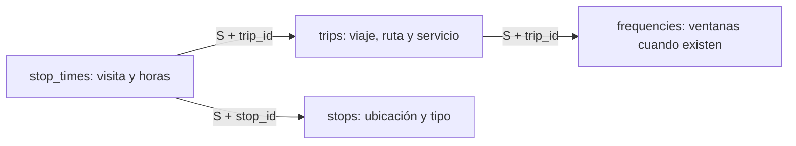

# Mi plan para stop_times

**Fecha:** 12 de noviembre de 2026. **Estado:** perfil completado y procesador Silver implementado localmente.
La publicación en Databricks permanece pendiente de validate y publish.
El [perfil medido](stop_times_profile_2025_2026.md) y el [contrato vigente](contracts/stop_times.md) cierran las decisiones propuestas aquí.
El incremento ocupa el orden 8 del [plan Silver](silver_design.md#siguiente-incremento-stop_times).
Las nueve entidades anteriores tienen despliegue funcional confirmado.

## Qué representa una fila

Una fila representa una visita planificada de un viaje a una parada.
Trip_id identifica el viaje plantilla. Stop_id identifica la parada. Stop_sequence identifica su posición dentro del viaje.
Arrival_time y departure_time describen llegada y salida planificadas.

Ejemplo ilustrativo, sin datos medidos:

| Viaje | Secuencia | Parada | Llegada | Salida |
| --- | ---: | --- | --- | --- |
| viaje_ejemplo | 1 | A | 08:00:00 | 08:00:00 |
| viaje_ejemplo | 5 | B | 08:10:00 | 08:11:00 |
| viaje_ejemplo | 9 | A | 08:20:00 | 08:20:00 |

La parada A aparece dos veces. Son visitas diferentes, no copias para eliminar.
La secuencia admite saltos. No exigiré números consecutivos ni un inicio en 1.

S significa source_feed_version + source_sha256.
La clave propuesta es S + trip_id + stop_sequence convertida.
La fuente es stop_times.txt y bronze_gtfs_stop_times. Propongo silver_gtfs_stop_times como salida.

## Qué comprobé y qué todavía desconozco

Ejecuté solamente dos consultas de metadata mediante Genie.
Recuperé 58 filas de esquema y dos observaciones de encabezados, completas y sin truncamiento.
Conservé las consultas exactas en el [notebook 17](../databricks/notebooks/silver/17_profile_gtfs_stop_times.ipynb).
Durante la planificación inicial consulté solo metadata. Después ejecuté los agregados del perfil de negocio.

| Snapshot | SHA-256 | Campos publicados |
| --- | --- | --- |
| 2025-10-28 | 07ba2ba9bb3b5bc1e38357355956757ce84fc68e6d05b74577bf017e189ab952 | trip_id, arrival_time, departure_time, stop_id, stop_sequence, timepoint |
| 2026-09-29 | 08d14e0b3a5b9caa5451b722659871fd554e3273b94bdd770fdf81a26bf02097 | Los seis anteriores, stop_headsign y shape_dist_traveled. |

Bronze contiene esos ocho campos históricos como string, además de cuatro columnas técnicas.
Las tablas Silver trips, stops y frequencies aparecen en el catálogo consultado.
La presencia de una tabla no demuestra la calidad ni la disponibilidad de cada snapshot.
El perfil comprobará esas condiciones.

El [runbook](notebook_runbook.md) conserva referencias históricas de 5.698.892 filas para 2025 y 9.408.893 para 2026.
Son antecedentes de volumen, no nuevos conteos obtenidos aquí.
El perfil posterior mide completitud, claves, rangos y coherencia temporal. El procesador comprueba nuevamente cada ejecución.

## Tipos iniciales por confirmar

| Campo | Tipo propuesto | Qué decidiré con el perfil |
| --- | --- | --- |
| trip_id | string | Identidad intacta y referencia a trips del mismo snapshot. |
| stop_id | string | Referencia y tipo de ubicación permitido para la visita. |
| stop_sequence | int inicialmente | Entero no negativo y rango representable. Evaluaré long si el rango requiere ampliación. |
| arrival_time | string nullable según regla | Formato, contenido y obligatoriedad según posición, timepoint y alcance admitido. |
| departure_time | string nullable según regla | Las mismas comprobaciones, con reglas propias de salida. |
| timepoint | int nullable | Dominio 0/1, ausencias y contexto de horarios exactos o estimados. |
| stop_headsign | string nullable | Contenido publicado por visita. No propagaré texto automáticamente. |
| shape_dist_traveled | double nullable | Conversión finita, signo, cobertura, orden y unidades disponibles. |
| arrival_time_seconds | long nullable | Derivado desde la hora informada, con desbordamientos detectados. |
| departure_time_seconds | long nullable | Derivado desde la hora informada, sin limitar el día de servicio a 24 horas. |

Esta tabla conserva las propuestas iniciales. El contrato vigente confirma los tipos e incorpora derivados explícitos.
Conservaré encabezado, procedencia, reglas y ejecución mediante las columnas técnicas existentes.
Las horas siguen agency_timezone. Los timestamps técnicos permanecen en UTC.
No convertiré una hora de servicio en un timestamp sin definir antes fecha y zona.
No añadiré pickup_type o drop_off_type como valores fuente: los encabezados actuales no los publican.
Un campo nuevo requerirá revisar el alcance del contrato.

## Etapas del trabajo

| Etapa | Qué haré | Resultado y condición de cierre |
| --- | --- | --- |
| 1. Metadata | Revisar esquemas y encabezados. | Completada; notebook 17 contiene dos consultas verificadas. |
| 2. Perfil masivo | Medir campos, claves, referencias, tiempos y contexto de frecuencias. | Completado; perfil con consultas verificadas y ejemplos acotados. |
| 3. Revisión y contrato | Explicar hallazgos y clasificar errores, advertencias y ausencias válidas. | Completado; contrato stop_times_v1 documentado. |
| 4. Implementación | Añadir procesador Spark y reutilizar notebook 10, auditoría y escritor. | Código y configuración preparados; verificación local registrada en la guía. |
| 5. Publicación | Ejecutar validate y después publish por snapshot. | Tabla consultada, claves reconciliadas e histórico preservado. |
| 6. Cierre | Registrar resultados reales y actualizar documentación. | Publicación comprobada sin confundir perfil, pruebas y ejecución real. |

Cerré el perfil y las decisiones del contrato antes de completar la implementación. La publicación permanece separada.
El notebook 17 será una guía de lectura. No será otra tarea obligatoria del Job.

## Preguntas del perfil masivo

1. **Campos y procedencia.** Mediré nulos, vacíos, solo espacios, espacios extremos y caracteres de control.
   Separaré columna ausente de columna publicada sin contenido.
   Comprobaré versión, hash, ruta y timestamp técnico antes de aceptar el snapshot.
2. **Claves y visitas.** Separaré copias idénticas de claves con atributos contradictorios.
   Detectaré colisiones después de convertir secuencias, como 01 y 1.
   Revisaré viajes con visitas repetidas, secuencias con saltos y cantidades mínimas de visitas.
3. **Referencias.** Comprobaré trip_id contra trips_v1 y stop_id contra stops_v1 dentro de S.
   Comprobaré paradas/plataformas con location_type 0 o vacío, según GTFS. No reemplazaré estaciones por sus hijos.
   Compararé conteos antes y después de cada join.
4. **Horas y posición.** Revisaré formatos, horas superiores a 24, desbordamientos y pares de llegada/salida incompletos.
   Identificaré primera y última visita mediante secuencia convertida, no por orden físico del TXT.
   Mediré llegada posterior a salida y retrocesos entre visitas.
   Las ausencias intermedias no deben ocultar un retroceso entre horas conocidas.
5. **Timepoint y destino.** Mediré valores 0/1, ausencias y combinaciones con horas informadas.
   Separaré los casos sin valores timepoint de los casos parcialmente informados.
   Revisaré stop_headsign sin copiar nombres de rutas ni completar automáticamente trip_headsign.
6. **Distancia publicada.** Mediré cobertura, negativos, valores no finitos, descensos e igualdades por viaje.
   No asumiré metros ni kilómetros. No calcularé distancia para rellenar el campo ausente.
   Shape_points no publica distancia en los snapshots revisados; eso limita una comparación directa de unidades.
7. **Frecuencias y cobertura.** Separaré viajes con ventanas de frecuencia de los demás viajes.
   Revisaré sus primeras horas y diferencias temporales antes de interpretar horarios.
   Detectaré viajes declarados sin visitas o con una sola visita y registraré el alcance del problema.

Cada consulta devolverá agregados o ejemplos limitados, no millones de registros.
Conservaré en el notebook solo las versiones definitivas verificadas.
El informe indicará si cada control cubre todo el snapshot o una muestra.

## Decisiones delicadas antes de programar reglas

| Situación | Decisión que debo cerrar |
| --- | --- |
| Horas ausentes | Distinguir ausencia permitida de incumplimiento según posición, timepoint y modalidad. No rechazar todos los null automáticamente. |
| Timepoint ausente | Conservar el valor fuente ausente. Hacer explícita cualquier interpretación predeterminada y distinguir ausencia total de información parcial. |
| Viaje por frecuencia | Interpretar tiempos relativos y ventanas sin fabricar horas exactas ni contar la plantilla como una salida adicional. |
| Parada repetida | Conservar visitas con secuencias diferentes. Revisar conflicto solamente cuando coincide la clave de visita. |
| Referencia a estación padre | Revisar tipo permitido. No sustituir la ubicación por sus hijos ni cambiar stop_id automáticamente. |
| Viaje sin visitas | Definir un bloqueo global o diagnóstico explícito. No fabricar una fila stop_times para enviarla a cuarentena. |
| Tiempos iguales | Distinguir espera cero, redondeo y anomalías. No imponer desigualdad estricta sin analizar el significado. |
| Distancia repetida o descendente | Contrastar estándar y fuente; documentar rechazo o advertencia antes de publicar. |
| Servicio flexible o continuo nuevo | Revisar el contrato y sus dependencias. No ignorar columnas para forzar compatibilidad. |

Los registros inválidos conservarán sus originales y motivos en cuarentena.
Un rechazo bloqueará el snapshot completo según la política actual.
Un control global no generará rechazos ficticios. Registro viajes sin visitas como diagnóstico de cobertura en resumen y auditoría.
No interpolaré horas ni corregiré calendarios de 2025 silenciosamente.

## Dependencias y ejecución previstas

Trips y stops Silver serán dependencias directas del mismo snapshot.
Frequencies aportará contexto cuando su archivo esté publicado; su ausencia opcional no debe bloquear feeds válidos.
Reduciré frequencies a IDs y contexto únicos antes del join. Varias ventanas no deben multiplicar visitas.
No exigiré service_dates para validar un ID o publicar visitas.
Tampoco uniré cada visita con todos los puntos de shape_points.

Prepararé publish_stop_times como décima tarea, después de publish_frequencies.
Mantendré notebook 10, parámetros por entidad/version/hash y concurrencia 1.
La plantilla local ya incorpora esa tarea y el registro habilita el procesador. El Job existente todavía requiere actualización manual.
Las listas seguirán manuales hasta implementar el pendiente 8b.

## Cómo controlaré el costo

Primero procesaré el snapshot 2025 y después el snapshot 2026.
Seleccionaré el hash y las columnas necesarias al comienzo. Validaré su versión sin ocultar registros inconsistentes.
Agruparé métricas por campo en pocas lecturas. Evitaré una consulta completa independiente por cada condición.
Reservaré las ventanas ordenadas para controles que realmente necesitan secuencia.
Usaré Spark nativo y evitaré UDF de Python, collect de visitas y ordenamientos globales para mostrar ejemplos.

Revisaré cuántas veces el escritor común evalúa los candidatos.
Solo persistiré un resultado reutilizado si el costo medido lo justifica y cabe en el entorno.
Liberaré esa persistencia al terminar, también ante errores.
No decidiré particionado, clustering ni cache solamente por la cantidad de filas.
Registraré duración y plan de ejecución cuando existan mediciones reales.
No expandiré todas las visitas por todas las fechas de service_dates.

## Pruebas y publicación previstas

Usaré fixtures pequeñas; no descargaré datos reales como única prueba.
Cubriré secuencias con saltos, visitas repetidas, copias, conflictos y colisiones de cast.
Probaré horarios después de medianoche, ausencia condicional, timepoint y retrocesos con valores intermedios ausentes.
Incluiré referencias inválidas, estaciones padre y plantillas con varias ventanas de frecuencia.
La integración Delta comprobará validate sin escritura, dos snapshots, reintento, cuarentena y preservación del histórico.
Reutilizaré el entorno existente de pruebas cuando comience la implementación.

Publicaré primero mediante validate y después mediante publish.
Compararé filas, claves y reconciliación con el perfil del mismo snapshot.
El cierre registrará resultados reales y cualquier limitación pendiente.
La verificación local queda registrada en la guía de ejecución. Todavía no publiqué esta tabla en Databricks.

## Qué habilita para Gold

Podré estudiar secuencias de visitas y duraciones planificadas entre paradas cuando existan horas utilizables.
Para oferta por fecha necesitaré calendarios activos y el tratamiento correcto de frecuencias.
Las filas no cuentan buses observados, pasajeros ni viajes efectivamente operados.
No utilizaré esta tabla para afirmar puntualidad, ocupación o velocidad operacional.
Cada futura tabla Gold completará la [ficha de negocio](silver_design.md#definición-de-negocio-obligatoria-para-cada-futura-tabla-gold).

La [referencia GTFS](https://gtfs.org/documentation/schedule/reference/#stop_timestxt) define semántica y obligatoriedad condicional.
El [ejemplo oficial de frecuencias](https://gtfs.org/documentation/schedule/examples/frequencies/) explica los tiempos relativos entre paradas.
El proyecto define identidad histórica, tipos físicos, políticas de calidad y publicación.

## Decisiones cerradas durante la implementación

Conservo 61 visitas aisladas de 2026 con advertencia. Registro 739 viajes sin visitas como diagnóstico global.
No corrijo secuencias válidas ni atribuyo causas a las ausencias.
Mantengo distancias repetidas como advertencia; un descenso produce rechazo. Esta tolerancia no equivale a conformidad estricta GTFS.
Mantengo los valores timepoint fuente separados de su interpretación efectiva.
La persistencia del resultado es optativa y queda desactivada para Serverless 4. Su liberación usa finally cuando la activo.
La décima tarea reutiliza notebook 10. Las nueve tareas anteriores conservan su configuración.
La publicación en Workspace y el planificador 8b siguen pendientes. Archify no cambia en este incremento.

## Clasificación de cobertura antes de las métricas Gold

**Decisión:** conservo las visitas disponibles en Silver y clasifico la cobertura antes de calcular métricas Gold.
La clasificación todavía no constituye una tabla ni una vista implementada.
Primero publicaré stop_times y comprobaré ambos snapshots. El planificador 8b mantiene su lugar en el plan.

Construiré una fila por source_feed_version + source_sha256 + trip_id declarado en trips Silver.
Agruparé stop_times Silver por esa misma clave antes del left join con trips.
Así conservaré viajes sin visitas y evitaré multiplicar filas.
El cero será un conteo derivado de visitas ausentes, no una visita fabricada.

| Cantidad de visitas | Clasificación propuesta | Significado |
| --- | --- | --- |
| 0 | sin_visitas | Trips declara el viaje, pero stop_times no aporta visitas publicadas. |
| 1 | una_visita | Solo puedo describir una visita publicada. |
| 2 o más | varias_visitas | Puedo estudiar una secuencia; todavía debo comprobar horas y alcance. |

Varias visitas no demuestran un recorrido completo ni un viaje efectivamente operado.
La cobertura y el contexto de frecuencias son propiedades distintas.
Una ventana de frequencies es una franja de servicio; no representa una visita adicional.

Antes de implementar este modelo completaré su ficha de negocio:

1. Responderá cuántos viajes declarados tienen visitas utilizables para cada análisis.
2. Una fila representará un viaje declarado dentro de su snapshot.
3. Contará las visitas Silver a paradas/plataformas; no añadirá estaciones padre.
4. Distinguirá cero visitas de horas ausentes. No interpolará horarios ni fabricará paradas.
5. Relacionará datos por versión, hash y trip_id; agregará visitas antes del join.
6. Power BI mostrará cobertura, exclusiones y contexto planificado. No presentará esos datos como operación observada.

Cada métrica definirá sus requisitos sobre esa clasificación.
Un conteo de viajes declarados incluirá los tres grupos.
Una duración entre paradas requerirá varias visitas y horas utilizables, además del tratamiento de frecuencias correspondiente.
Los análisis de oferta por fecha necesitarán también calendarios activos.
Registraré la cantidad excluida y su motivo para evitar denominadores ocultos.
